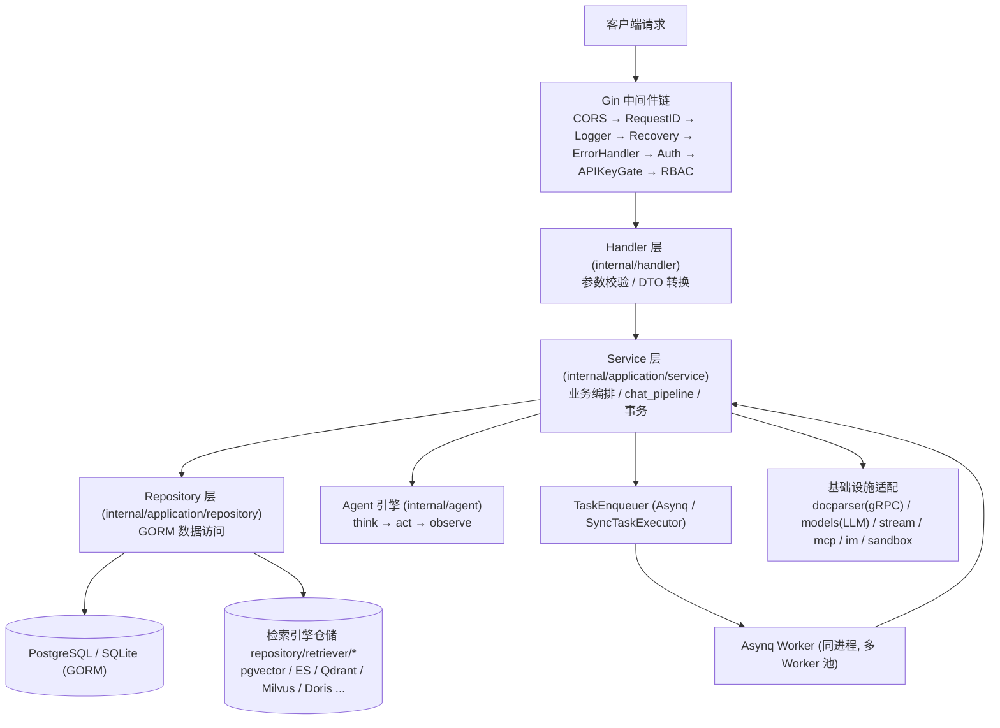
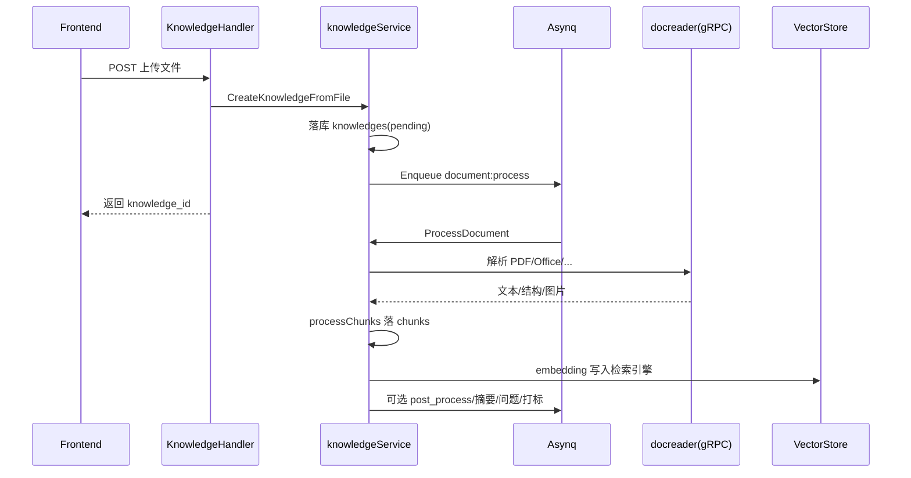
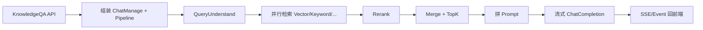
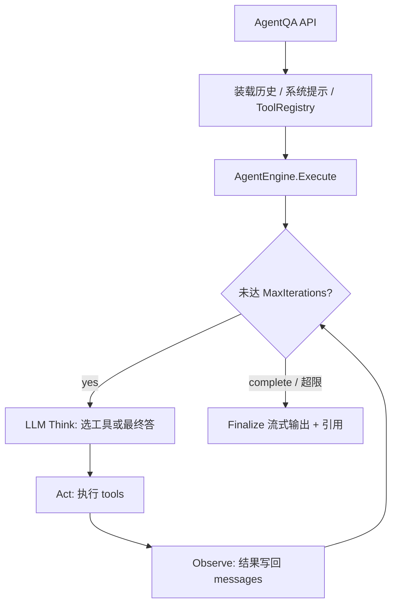

# WeKnora Go 后端熟悉路径

> 面向需要快速建立心智模型、并深入「知识库解析 / RAG 对话 / 智能体」三条主线的阅读指南。  
> 文档 + 代码对照阅读；冲突时以源码为准。

---

## 0. 先建立心智模型

后端不是「一堆 handler」，而是：

```text
HTTP(Gin) → Handler → Service → Repository / 外部系统
                ↓
         Asynq Worker（同进程）→ 再回调同一套 Service
```

| 层 | 目录 | 职责 |
|----|------|------|
| 入口 | `cmd/server/main.go` | 启服、优雅退出 |
| DI | `internal/container/container.go` | dig 装配一切 |
| 路由 | `internal/router/` | URL → Handler |
| Handler | `internal/handler/`、`handler/session/` | 参数/鉴权后调 Service |
| Service | `internal/application/service/` | **业务核心** |
| Repo | `internal/application/repository/` | GORM |
| 领域 | `internal/types/` | 实体、任务类型、接口 |
| Agent | `internal/agent/` | ReAct 引擎 |
| 解析侧车 | `docreader/`（Python gRPC） | 真正读 PDF/Office |

公司定制前端在 `apps/frontend`，但 **Go 后端主体仍在仓库根 `internal/`**。

### 推荐配套文档

| 文档 | 内容 |
|------|------|
| `website-docs/02-architecture/02-backend-design.md` | 分层 / DI |
| `website-docs/02-architecture/03-document-pipeline.md` | 解析流水线 |
| `website-docs/02-architecture/04-rag-pipeline.md` | 对话检索 |
| `website-docs/02-architecture/05-async-tasks.md` | Asynq |
| `docs/QA.md` | 问答相关说明 |
| `docs/CHUNKING.md` | 分块策略 |

### 整体分层示意



---

## 第 1 阶段：从入口摸清「请求怎么进来」（约 1 天）

### 1.1 启动链（按顺序读）

1. `cmd/server/main.go`  
   - `container.BuildContainer` → `Invoke` 拿到 `*gin.Engine` → Listen  
2. `internal/container/container.go` 的 `BuildContainer`（可略读细节，抓住阶段顺序）  
   - config / DB / Redis / Repo / Service / **chat_pipeline 插件** / Handler / Router / **Asynq**  
3. `internal/router/router.go` → `NewRouter`  
   - 中间件链、`/api/v1` 下 `Register*Routes`  
4. 挑两条路由文件对照：  
   - `routes_knowledge.go`（上传/知识）  
   - `routes_chat.go`（`/knowledge-chat`、`/agent-chat`）

**目标问题：**  
「一个 HTTP 请求经过哪些中间件？落到哪个 Handler？Handler 调哪个 Service 接口？」

### 1.2 横切能力（半小时扫一眼即可）

- `internal/middleware/`：Auth、RBAC、RequestID  
- `internal/types/interfaces/`：Service 契约清单  
- `internal/errors/`：错误信封  
- `internal/logger/`：日志字段习惯  

**验收：** 能从 Swagger/`docs/swagger.yaml` 或前端 Network，把某个 API 对上 Handler 函数名。

---

## 第 2 阶段：领域模型与存储（约 0.5–1 天）

先读实体，再读流程，否则 `knowledge_process.go` 会 dig：

| 文件 | 关注点 |
|------|--------|
| `internal/types/knowledge.go` | Knowledge、ParseStatus |
| `internal/types/knowledgebase.go` | KB 类型、分块/索引配置 |
| `internal/types/chunk.go` | ChunkType |
| `internal/types/session.go` / `message.go` | 会话消息 |
| `internal/types/task.go` | `TypeDocumentProcess`、队列与 Worker 池 |
| `migrations/versioned/` 最近几条 | 表演进（如 079 folder_path、080 auto_tag_config） |

**目标问题：**  
「一条文档从上传到可检索，库里会有哪些表行？状态字段怎么变？」

---

## 第 3 阶段：知识库解析入库（核心链路 A，约 2–3 天）

这是「数据怎么进系统」的主线。

### 3.1 同步入口（上传）

按调用顺序读：

```text
handler/knowledge.go
  CreateKnowledgeFromFile
    → service/knowledge_create.go
         CreateKnowledgeFromFile
           写 knowledges 行
           Enqueue asynq: TypeDocumentProcess
```

配套：`internal/application/service/knowledge_task_options.go`（队列/超时）

### 3.2 异步 Worker 注册

```text
internal/router/task.go          # 注册 ProcessDocument 等 handler
internal/types/task.go           # 任务类型与 QueueDefault 等
internal/application/service/knowledge_process.go
  ProcessDocument                # ~3149 行起，主干
```

### 3.3 ProcessDocument 建议阅读顺序（不要通读整文件）

1. `ProcessDocument`：幂等（completed/cancelled/deleting）、取 KB  
2. `callDocReaderWithTimeout` / `resolveDocReader`：如何调 **docreader gRPC**  
3. `convert`：docreader 结果 → 内部结构  
4. `processChunks`：切块、落库、向量化（`updateChunkVector`）  
5. 后置任务：`TypeKnowledgePostProcess`、摘要/问题生成、图片多模态、`TypeKnowledgeAutoTag`、Wiki ingest  

侧车解析服务（需要时再进）：

- Go 客户端：`internal/infrastructure/docparser/`  
- Python：`docreader/main.py`、`docreader/parser/`  
- 分块策略：`internal/infrastructure/chunker/` + `docs/CHUNKING.md`

### 3.4 流程图：文档解析入库



**动手建议：**  
本地上传一个小 PDF，跟日志关键字：`Start creating knowledge`、`Processing document task`、`ParseStatus`。

**验收：**  
能口述：上传接口 → 哪些字段入库 → 哪个 task type → 谁调 docreader → chunk/vector 何时写完。

---

## 第 4 阶段：对话 / RAG 核心（核心链路 B，约 2–3 天）

两条 HTTP 入口在 `internal/router/routes_chat.go`：

| API | Handler | Service |
|-----|---------|---------|
| `POST /knowledge-chat/:session_id` | `handler/session/qa.go` → `KnowledgeQA` | `session_knowledge_qa.go` |
| `POST /agent-chat/:session_id` | 同上 → `AgentQA` | `session_agent_qa.go` |

### 4.1 KnowledgeQA（RAG）阅读顺序

1. `internal/handler/session/qa.go`：`KnowledgeQA` / 流式响应、EventBus  
2. `session_knowledge_qa.go`：`KnowledgeQA`  
   - resolve KB / model / searchTargets  
   - **组装 pipeline**（约 180–198 行）  
3. `KnowledgeQAByEvent`：按 stage 触发 `chat_pipeline`  
4. `internal/application/service/chat_pipeline/` 按 stage 读插件  

推荐 RAG 顺序（与代码一致）：

```text
LOAD_HISTORY（可选）
→ QUERY_UNDERSTAND          # query_understand.go
→ CHUNK_SEARCH_PARALLEL     # search.go / search_parallel.go
→ CHUNK_RERANK              # rerank.go
→ WEB_FETCH（可选）
→ CHUNK_MERGE               # merge.go 及 merge_*.go
→ FILTER_TOP_K
→ DATA_ANALYSIS（可选）
→ INTO_CHAT_MESSAGE         # into_chat_message.go
→ CHAT_COMPLETION_STREAM    # chat_completion_stream.go
```

框架胶水：`chat_pipeline/chat_pipeline.go`（Plugin / EventManager）

模型适配：`internal/models/chat/`  
检索实现：`internal/application/repository/retriever/*`

### 4.2 流程图：RAG 对话



**说明：**  
- **有 KB**：走完整 RAG pipeline（上图）。  
- **无 KB 纯聊**：`LOAD_HISTORY`（可选）→ `CHAT_COMPLETION_STREAM`，见 `session_knowledge_qa.go` 中 `hasKB` 分支。

**验收：**  
能画出「无 KB 纯聊」vs「有 KB 的 RAG」两条 pipeline 差异。

---

## 第 5 阶段：智能体 Agent（核心链路 C，约 2 天）

在 RAG 之后读，因为 Agent **复用检索工具**，不是另一套平行世界。

### 5.1 阅读顺序

1. `handler/session/qa.go` → `AgentQA`  
2. `session_agent_qa.go`：准备 AgentConfig、工具注册、历史 `LoadAgentHistory`  
3. `internal/agent/engine.go` → `Execute`（ReAct 主循环）  
4. 同包：`think.go` / `act.go` / `observe.go` / `finalize.go` / `prompts.go`  
5. 工具箱 `internal/agent/tools/`（先读这些）：  
   - `knowledge_search.go`（最重要）  
   - `grep_chunks.go`、`get_document_info.go`、`list_knowledge_chunks.go`  
   - `mcp_tool.go`、`query_knowledge_graph.go`、`database_query.go`  
6. 自定义 Agent：`handler/custom_agent.go` + `service/custom_agent.go` + `types/custom_agent.go`  
7. MCP：`internal/mcp/` + `docs/MCP功能使用说明.md`

### 5.2 流程图：Agent ReAct



**验收：**  
能说清：Agent 一轮里 LLM 何时调 `knowledge_search`，检索结果如何变成引用，与 KnowledgeQA 的「固定 pipeline」差别是什么（固定流水线 vs 动态 ReAct）。

---

## 第 6 阶段：横向加深（按需）

学完三条主线后再按兴趣插：

| 主题 | 入口 |
|------|------|
| 租户/RBAC | `routes_auth_tenant.go`、`docs/RBAC说明.md` |
| 模型管理 | initialization / model service、`internal/models/` |
| 数据源同步 | `service/datasource_service.go`、`TypeDataSourceSync` |
| Wiki | `TypeWikiIngest` / `TypeWikiFinalize`、wiki handler |
| IM/Embed | `internal/im/`、`embed_channel` |
| 可观测 | Langfuse span（QA/Agent 里大量 `StartSpan`）、`docs/Langfuse集成.md` |
| 公司定制 | 对照 `apps/` 与 Jenkins；后端仍以 `internal/` 为准 |

---

## 推荐 2 周节奏（可压缩）

| 天数 | 内容 | 产出 |
|------|------|------|
| D1 | 入口 + Router + 中间件 | 画「请求生命周期」一页纸 |
| D2 | types + 上传 CreateKnowledge | 跟一次上传 API |
| D3–D4 | ProcessDocument + docreader + chunk/vector | 画解析时序图 |
| D5–D6 | KnowledgeQA + chat_pipeline 各插件 | 画 RAG 阶段图 |
| D7–D8 | AgentQA + Engine + knowledge_search tool | 对比 RAG vs Agent |
| D9 | 选一条支线（MCP / Wiki / 数据源） | 笔记 |
| D10 | 自己改一个小点或写调试日志验证理解 | 闭环 |

---

## 阅读纪律（避免迷路）

1. **永远先找 HTTP/Task 入口，再往下钻**，不要从 `knowledge_process.go` 中间跳读。  
2. **大文件只读「函数目录 + 主干函数」**：`knowledge_process.go`、`knowledge.go` handler 都很大。  
3. **用一条真实请求串起来**：上传 → 看 DB parse_status → 再发 knowledge-chat → 看日志 stage。  
4. **接口优先于实现**：先看 `types/interfaces`，再跳具体 struct。  
5. **文档当地图、代码当真相**：架构文档与源码不一致时以源码为准。

---

## 最小必读文件清单

```text
cmd/server/main.go
internal/container/container.go          # 扫阶段即可
internal/router/router.go
internal/router/routes_knowledge.go
internal/router/routes_chat.go
internal/router/task.go
internal/types/task.go
internal/handler/knowledge.go            # CreateKnowledgeFromFile
internal/application/service/knowledge_create.go
internal/application/service/knowledge_process.go  # ProcessDocument
internal/handler/session/qa.go
internal/application/service/session_knowledge_qa.go
internal/application/service/session_agent_qa.go
internal/application/service/chat_pipeline/*.go    # 按 stage
internal/agent/engine.go
internal/agent/tools/knowledge_search.go
```

---

## 三条主线对照（速查）

| 主线 | HTTP / Task 入口 | 核心文件 | 模式 |
|------|------------------|----------|------|
| 解析入库 | 上传 API → `document:process` | `knowledge_create.go` / `knowledge_process.go` | 异步任务 + docreader |
| RAG 对话 | `POST /knowledge-chat/:session_id` | `session_knowledge_qa.go` + `chat_pipeline/` | 固定阶段流水线 |
| 智能体 | `POST /agent-chat/:session_id` | `session_agent_qa.go` + `agent/engine.go` | ReAct 动态调工具 |

按本文路径走完，即可对「解析入库 + RAG 对话 + Agent」形成可调试的心智模型。
