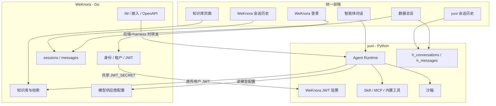

# WeKnora × yuxi 能力聚合改造计划

> 本文档是分阶段执行手册。**每个阶段的验收门禁全绿之前，不进入下一阶段。**
>
> **收尾约定**：P0–P9 全部完成且门禁通过后，**删除本文件**（`WEKNORA_YUXI_INTEGRATION_PLAN.md`），不要作为长期文档留在仓库。协议与实现以代码和正式文档为准。
>
> 环境：本机（[docker-compose-mac.yml](docker-compose-mac.yml)），Postgres 容器 `postgres17`，业务库 `WeKnora`。
>
> **本机进程拓扑（以实际开发方式为准，不要按全 Docker 验收）**
>
> | 进程 | 启动方式 | 说明 |
> | --- | --- | --- |
> | WeKnora 后端 | PyCharm / `make dev-app`（`scripts/dev.sh app`） | **不是** `agent-middle-app` 容器。从仓库根 `.env`（可被 `.env.local` 覆盖）加载 `JWT_SECRET` |
> | WeKnora 前端 | PyCharm / `make dev-frontend` | **不是** `agent-middle-frontend` / `agent-middle-UI` 容器。Vite `:9988` 代理到本机 app `:9980` 与 harness `:5050` |
> | harness API / Worker | Docker `harness` profile | 容器 `agent-middle-harness-api` / `agent-middle-harness-worker`，同一份 `.env` 注入 `JWT_SECRET` |
> | 基础设施 | Docker（postgres / redis / minio 等） | `make dev-start` 或 compose |
>
> 前置状态：harness 业务表已以 `h_` 前缀合入 `WeKnora` 库（迁移 `000082_harness_tables`）。本机 `schema_migrations.version` 可能为 82 或遗留 83。
>
> **本机身份数据**：`h_users` 当前只有 1 个用户（`id=1`，`uid=admin`），就是为能力融合准备的，**不按多用户迁移设计**。P1.8 只处理这一行。

---

## 0. 目标与原则

### 0.1 目标架构

> **WeKnora = 身份 / 租户 / 知识库 / 对外接入（IM、网页嵌入、API）**
> **yuxi = 智能体运行时（Skill、MCP、内置工具、沙箱、Run 编排）**

两边同库、同 token，通过**内部 HTTP 接口 + yuxi 已有抽象层**拼接，不做表级混合。



### 0.2 改造原则

1. **每次变更力求最小化**，能用现有抽象层就不新造结构。
2. **WeKnora 非必要不改动**，优先改 yuxi（Python）。确需改 WeKnora 的范围收敛为 P0/P3 的最小全文接口（仅在 chunks 方案失败时）、P7 内部模型代理与 P8 对外入口分流。
3. **所有代码改动带开关**，保证任何阶段都能一键回滚。
4. **禁止删除或覆盖现有业务数据**：本计划内不得对现有业务表执行 `DROP TABLE`、`TRUNCATE` 或不可逆 `DELETE`；不得删除 MinIO、工作区目录和索引中的历史数据。
5. 每阶段结束产出一份可重复执行的验收清单。
6. **所有迁移必须可逆**：变更前完成可恢复备份，数据改写必须保存旧值映射和反向恢复脚本；未实际验证回滚，不得通过阶段门禁。
7. 优先采用新增列、影子表、双读/双写开关和停止写入，避免原地覆盖。新增列允许旧代码忽略，回滚时不必立即删除列。
8. 临时 JWT/锁/缓存等非业务数据可按 TTL 自动删除，但不得删除用户、会话、消息、知识库、智能体、Skill、MCP、模型配置及文件数据。
9. P9 只做停用、隔离和归档标记；物理删表或清除历史数据不属于本计划，必须另立需求并再次人工批准。

### 0.3 已确认决策

| 议题 | 决策 |
| --- | --- |
| 用户体系 | 统一用 WeKnora `users`；yuxi 做兼容 |
| Token | 统一用 WeKnora JWT，yuxi 侧解析 |
| WeKnora Agent | **长期并存**，与 yuxi 智能体共存，用户可选 |
| 知识库适配深度 | **全能力**（检索 + 打开文档 + 文件内定位 + 下载 + 文件列表） |
| yuxi 知识库注册表 | **不保留**，`list_kbs` 实时透传 WeKnora |
| 对话历史 | **不聚合、不迁移，各自独立查询和展示** |
| 部门概念 | **移除** |
| 模型供应商 | **统一到 WeKnora**，yuxi 通过内部模型代理调用，不读取明文密钥 |
| 下载权限 | **接受限制**（Viewer 用户的智能体无法下载原件） |
| yuxi 调 WeKnora 凭证 | **透传用户 JWT** |
| 验证环境 | 本机开发、测试、验证：WeKnora app/UI 用 `make dev-app` / `make dev-frontend`，harness 用 Docker |
| 本机用户范围 | `h_users` 仅 1 人，按单用户融合处理，不展开多用户匹配流程 |

### 0.4 两套系统的配置必须显式对齐

融合是逐步的，两边继续各自读配置。**同一语义的参数必须来自同一份仓库根 `.env`，禁止各写各的、禁止把 WeKnora 密钥写进 yuxi 的 fallback。** 打开下一阶段开关前，先核对本表。

| 参数 | WeKnora（`make dev-app` / 前端） | yuxi / harness | 融合约定 |
| --- | --- | --- | --- |
| `JWT_SECRET` | 签发与验签 WeKnora access/refresh | 验 WeKnora JWT（P1 主路径） | **必须相同且非空**。`docker-env.py` 与 `weknora_auth.py` 空则失败，不随机生成 |
| `JWT_SECRET_KEY` | 不使用 | yuxi 旧 JWT（`AuthUtils`） | **过渡期保留、不得改成 `JWT_SECRET`**。P1.7 后关闭 legacy |
| `DB_NAME` / `DB_USER` / `DB_PASSWORD` | 业务库 `WeKnora` | 同一库，表加 `h_` | 已同库。不要再指向旧 `agent_harness` |
| `HARNESS_TABLE_PREFIX` | 不使用 | 默认 `h_` | 保持 `h_`，不要改 |
| Redis | WeKnora 自己的 DB 号 | `AGENT_HARNESS_REDIS_DB`（默认 2） | 可分库；P0/P1 缓存键带前缀即可 |
| `HARNESS_WEKNORA_IDENTITY` | 不使用 | 默认关 | 打开后 harness 接受 WeKnora JWT 并投影 |
| `HARNESS_LEGACY_JWT_ENABLED` | 不使用 | 默认开 | P1 期间保持开；门禁后再关 |
| `HARNESS_P0_RUN_TOKEN_STORE` / `HARNESS_P0_CHECK_AUTH_TOKENS` | 不使用 | 默认关 | Worker 透传 JWT；P3 调 KB 前再开 |
| `HARNESS_LOCAL_LOGIN_ENABLED` | 不使用 | 代码默认开；本机 `.env` / compose 关 | P1.7 已实现。false 时密码/OIDC/初始化/用户增删改 404 |
| 前端 Token | `localStorage.weknora_token` | 每次现读 `weknora_token` | P1.6 已切。不再读 `harness_user_token` / `VITE_HARNESS_TOKEN` |
| 前端代理 | Vite `:9988` → `APP_PORT`/`APP_LISTEN_PORT`（kjsc 9980） | `VITE_HARNESS_PROXY_TARGET` → `:5050` | 与 `.env.kjsc.example` 的 `APP_PORT=9980` 对齐。Docker 容器内仍听 8080 |
| 模型密钥 | 只留在 WeKnora（`SYSTEM_AES_KEY` 加密） | 不读明文 | P7 内部代理；P0 已冻结协议 |

改 `.env` 后：本机 `dev-app` / `dev-frontend` 需重启进程；harness 需 recreate `api`/`worker`。只改一边会导致“一边 200、一边 401”。

---

## 1. 阶段总览

| 阶段 | 内容 | 改动侧 | 复杂度 |
| --- | --- | --- | --- |
| P0 | 阻断项技术验证（Worker JWT、全文读取、模型代理、外部身份协议） | 两侧，只做验证 | 中 |
| P1 | 身份统一（WeKnora JWT + `h_users` 降级为投影表） | yuxi + 前端 | 中 |
| P2 | 租户贯通 + 部门移除 | yuxi | 中 |
| P3 | 知识库统一（WeKnora KB 适配器） | yuxi | 中 |
| P4 | 前端收口（知识库单一入口） | 前端 | 低 |
| P5 | 会话存储与查询隔离验证 | 两侧，仅验证/修补 | 低 |
| P6 | 数据总览分系统统计 | yuxi | 中 |
| P7 | 模型供应商统一到 WeKnora（内部模型代理） | WeKnora + yuxi | 高 |
| P8A | 单个 IM 渠道接入 yuxi | WeKnora + yuxi | 高 |
| P8B | 网页嵌入接入 yuxi | WeKnora + yuxi | 高 |
| P8C | API 接入 yuxi | WeKnora + yuxi | 高 |
| P8D | 推广到其他 IM 渠道 | WeKnora + yuxi | 中 |
| P9 | 废弃能力停用与数据保留 | 两侧 | 低 |

---

## P0 · 阻断项技术验证

> P0 只做受功能开关保护的最小原型与验证，不迁移、不覆盖、不删除业务数据，不切正式路径。所有原型必须可关闭，四项全部验证通过且回滚验证成功后才能进入 P1。

### P0.1 API → Worker 的用户 JWT 传递

当前 ARQ 入队只传 `run_id`，Worker 仅按 `uid` 加载投影用户，无法透传 WeKnora JWT。验证以下方案：

1. API 验票后将用户 access token 加密或放入 Redis 临时凭证记录，以 `run_id` 为键。
2. 凭证设置不超过 access token 剩余有效期的 TTL；任务终止后删除。
3. 禁止把明文 JWT 写入 `h_agent_runs.input_payload`、日志、事件或接口响应。
4. Worker 开始和恢复 Run 时重新校验 token；调用 WeKnora 时使用原始 Bearer token。
5. token 过期/吊销时终止依赖 WeKnora 的操作并返回明确错误。

验证点：正常 Run、排队后执行、重试、取消、登出后执行、凭证过期、Worker 重启恢复。

### P0.2 WeKnora 文档全文读取

确认 `GET /knowledge/:id` 与 `/spans` 不提供解析全文后，验证分页读取 `/chunks/:knowledge_id` 能否按 `chunk_index` 重建 document 类型正文，包括：

- 大于 100 个 chunk 的分页；
- chunk 重叠去重与顺序；
- FAQ / Wiki 类型的差异；
- 大文档的延迟与内存占用。

若无法稳定重建，再在 WeKnora 新增最小、只读、复用现有 KB 权限守卫的“解析正文”接口。

### P0.3 模型统一方案

WeKnora 的模型响应会主动剥离 `APIKey` / `AppSecret`，yuxi 不能仅靠 `GET /models` 运行模型。本计划采用**内部模型代理**：

- 密钥始终留在 WeKnora；
- yuxi 透传用户 JWT、tenant 和模型 ID 调内部代理；
- 代理覆盖 chat、embedding、rerank；OCR 单独确认是否仍需保留 yuxi 配置；
- 不新增“返回明文模型密钥”的接口。

P0 先验证一次非流式、一次流式 chat，以及 embedding/rerank 调用。

### P0.4 外部渠道协议

IM、嵌入访客和 API external user 不是 `users.id`，不能套用 P1 的用户 JWT 投影。先定义并验证：

- WeKnora → harness 的短时内部身份断言：`principal_type`、`principal_id`、`tenant_id`、`backend_agent_id`、`aud`、`exp`；
- WeKnora Agent UUID 与 yuxi `agent_slug` 的后端绑定字段；
- yuxi Run 事件到 WeKnora 流式事件的 SSE/Webhook/轮询桥接；
- `stop`、工具步骤、审批、`ask_user_question` 和 MCP OAuth 的支持/降级规则；
- `backend=harness` 时不创建 WeKnora `sessions/messages`。

### P0.5 验收门禁

- [x] Worker 能安全取得用户 JWT，且数据库、日志、响应中无明文泄漏
- [x] 登出、过期和重试场景行为明确并通过
- [x] document 全文可重建，或最小全文接口方案已确定
- [x] 模型代理完成 chat/stream/embedding/rerank 原型
- [x] 外部身份断言、Agent 绑定和 Run 事件桥接协议已冻结
- [x] 关闭全部 P0 开关后环境恢复到验证前行为，历史数据和文件数量完全一致
- [x] 任一项未通过，停止，不进入 P1

### P0 执行记录（2026-08-29）

本机验证，未打开 compose 开关，未迁移/覆盖/删除业务数据。`postgres17` / `WeKnora` 行数验证前后一致：`users=1`，`auth_tokens=34`，`sessions=0`，`messages=0`，`knowledge_bases=1`，`knowledges=0`，`chunks=0`，`h_users=1`，`h_conversations=3`，`h_messages=55`，`h_agent_runs=8`，`schema_migrations=1`（version=83）。`models=6`（只计行数，未读密钥列）。

| 项 | 结论 | 证据 |
| --- | --- | --- |
| P0.1 JWT 传递 | **通过** | 开关 `HARNESS_P0_RUN_TOKEN_STORE` / `HARNESS_P0_CHECK_AUTH_TOKENS` 默认关。打开后 API 把 Bearer 放入 Redis `p0:run-token:{run_id}`，TTL ≤ JWT 剩余寿命（最长 24h），不写 `input_payload`/日志。Worker 复验；过期/吊销标 `weknora_token_invalid` 并终止；缺失 token 走旧路径。任务结束删键。单测覆盖 enqueue、TTL、吊销、过期失败、缺失放行。 |
| P0.2 全文 | **通过（方案确定）** | `GET /knowledge/:id` 仍只是元数据。采用分页 `/chunks/:knowledge_id`（`page_size` 上限 100），按 `chunk_index`/`start_at`/`end_at` 重建；偏移全 0 时回退顺序拼接；FAQ=entry、Wiki=page，不拼成一篇文章。本机无 document 样本（0 knowledge / 0 chunk），未新增 WeKnora 全文接口。有文档后重跑 `apps/agent-harness/scripts/p0_verify.py`。 |
| P0.3 模型 | **通过（协议冻结）** | 内部代理协议：`task ∈ {chat,chat_stream,embedding,rerank}`，只传 `model_id`+`tenant_id`+输入，禁止携带密钥。现网 `POST /api/v1/models/:id/debug` 已能在服务端持钥调用 KnowledgeQA ChatStream / Embed / Rerank，且不写 `sessions/messages`；`GET /models` 经 DTO 剥离 `APIKey`/`AppSecret`。禁止用 `knowledge-chat`/`agent-chat` 当代理。P0 **未**对现网发起 debug 调用。真正的内部代理在 P7 实现。 |
| P0.4 渠道 | **通过（协议冻结）** | HS256 内部断言：`iss=weknora`，`aud=weknora-harness-internal`，claims=`principal_type/principal_id/tenant_id/backend_agent_id/exp`。`principal_type`：`web_user`/`im_user`/`embed_session`/`embed_visitor`/`api_external_user`。Agent 绑定字段名冻结为 `harness_agent_slug`（P8 再落库）。事件桥：sse/webhook/poll；run 事件 `metadata/chunk/interrupt/error/end`。`stop`/`tool_step`/`approval`/`ask_user_question` 支持；`mcp_oauth` 降级。`backend=harness` 禁止 `resolveSession()`、禁止写 WeKnora `sessions/messages`。未接入现网 IM。 |
| 回滚 | **通过** | 开关未写入 `docker-compose-mac.yml`，默认关闭即恢复验证前行为。Redis 键有 TTL，无业务表 DDL/DML。 |

回滚方法：保持或删除 `HARNESS_P0_RUN_TOKEN_STORE`、`HARNESS_P0_CHECK_AUTH_TOKENS`；无需回滚 SQL。

相关代码：`apps/agent-harness/package/yuxi/p0/`，`apps/agent-harness/scripts/p0_verify.py`，Worker/入队钩子在 `run_worker.py` / `agent_run_service.py` / `auth_middleware.py`。

**P0 门禁全绿，可以进入 P1。** 不自动开始 P1。

---

## 2. 关键接缝（改造可行性的基础）

### 2.1 知识库插件层（P3 的基础）

yuxi 有干净的知识库抽象：`KnowledgeBase` 抽象基类 + `KnowledgeBaseFactory.register()` + 只读连接器基类，已有 `dify` / `notion` 两个外部连接器先例。

- [apps/agent-harness/package/yuxi/knowledge/base.py](apps/agent-harness/package/yuxi/knowledge/base.py) — 抽象基类
- [apps/agent-harness/package/yuxi/knowledge/factory.py](apps/agent-harness/package/yuxi/knowledge/factory.py) — 类型注册工厂
- [apps/agent-harness/package/yuxi/knowledge/implementations/read_only_connectors.py](apps/agent-harness/package/yuxi/knowledge/implementations/read_only_connectors.py) — 只读连接器基类
- [apps/agent-harness/package/yuxi/knowledge/runtime.py](apps/agent-harness/package/yuxi/knowledge/runtime.py) — 全局出口 `knowledge_base`

Agent 侧 7 个知识库工具全部经由 `yuxi.knowledge.runtime.knowledge_base` 单一出口，**工具代码一行不用改**：

- [apps/agent-harness/package/yuxi/agents/toolkits/kbs/tools.py](apps/agent-harness/package/yuxi/agents/toolkits/kbs/tools.py)

### 2.2 WeKnora sessions 已是用户级（P5 / P8 的基础）

```84:87:internal/types/session.go
	TenantID uint64 `json:"tenant_id"   gorm:"index"`
	// UserID is the owner scope for this session. WeKnora user UUIDs, API
	// external-user principals, and embed visitor principals all use this column.
	UserID string `json:"user_id,omitempty" gorm:"type:varchar(512);index"`
```

注释明确 IM/API 外部用户、嵌入访客都复用这一列。

### 2.3 yuxi 已有统一对外调用层（P8 的基础）

- [apps/agent-harness/server/routers/agent_invocation_channel_router.py](apps/agent-harness/server/routers/agent_invocation_channel_router.py) — 纯文本 Channel 入口
- [apps/agent-harness/server/routers/agent_invocation_call_router.py](apps/agent-harness/server/routers/agent_invocation_call_router.py) — OpenAI 兼容接口

底层统一收敛到 `submit_run_command(RunOrigin, ...)`。P8 不需要在 yuxi 侧从零开发。

### 2.4 nginx 直连 harness，Go 不参与鉴权

```140:146:apps/frontend/nginx.conf
    # Agent-Harness API：浏览器请求 /harness-api/api/... ，转成 FastAPI 的 /api/...
    location /harness-api/ {
        set $harness_upstream ${HARNESS_SCHEME}://${HARNESS_HOST}:${HARNESS_PORT};
        rewrite ^/harness-api/(.*)$ /$1 break;
        proxy_pass $harness_upstream;
```

结论：**harness 必须自己验签**，无法依赖网关注入身份。

---

## 3. 身份现状对照（P1 参考）

| 维度 | WeKnora `users` | yuxi `h_users` |
| --- | --- | --- |
| 主键 | UUID `varchar(36)` | SERIAL `int` |
| 登录名 | `email` | `uid` / 手机号 |
| 密码 | bcrypt | argon2 |
| JWT 密钥 | `JWT_SECRET` | `JWT_SECRET_KEY` |
| JWT 载荷 | `user_id` + `email` + `tenant_id` + `type=access`，**无** `sub`/`iss`/`aud` | 强制 `sub`/`iss`/`aud=yuxi-know-api` |
| 有效期 | access 24h / refresh 7d | 7d |
| 角色 | 空间 membership + `is_system_admin` | `superadmin` / `admin` / `user` + **必须** `department_id` |
| 前端存储 | `localStorage.weknora_token` | `localStorage.harness_user_token` |

yuxi 现有验票逻辑（要改的地方）：

```80:93:apps/agent-harness/server/utils/auth_middleware.py
    # JWT Token 认证
    try:
        payload = AuthUtils.verify_access_token(token)
        user_id = payload.get("sub")
        ...
    result = await db.execute(select(User).filter(User.id == int(user_id), User.is_deleted == 0))
```

WeKnora 签发逻辑（**不改**），见 [internal/application/service/user.go](internal/application/service/user.go) 的 `generateTokensForTenant`。

---

## 4. `h_*` 表用户标识字段总清单

> P1.8（uid remap）与 P9（停用/归档）都依赖这份清单。**漏掉任何一列都会造成资源"所有人丢失"或"数据不可见"。**

### A 组 · `uid` 字符串（业务主身份，需 remap）

| 表 | 列 | 类型 / 约束 |
| --- | --- | --- |
| `h_conversations` | `uid` | VARCHAR(64) NOT NULL，索引 |
| `h_agent_runs` | `uid` | VARCHAR(64) NOT NULL，索引 |
| `h_agent_run_requests` | `uid` | VARCHAR(64) NOT NULL，复合索引 `ix_agent_run_requests_queue` |
| `h_subagent_threads` | `uid` | VARCHAR(64) NOT NULL，索引 |
| `h_message_feedbacks` | `uid` | VARCHAR(64) NOT NULL，索引 |
| `h_agent_envs` | `uid` | VARCHAR NOT NULL，UNIQUE + **FK → `h_users.uid`** |
| `h_user_config` | `uid` | VARCHAR NOT NULL，UNIQUE + **FK → `h_users.uid`** |
| `h_users` | `uid` | VARCHAR NOT NULL，UNIQUE（remap 锚点） |

### B 组 · `created_by` / `updated_by`（同为 uid 字符串，决定资源所有权）

| 表 | 列 | 类型 |
| --- | --- | --- |
| `h_agents` | `created_by`, `updated_by` | VARCHAR(64)，索引 `ix_h_agents_created_by` |
| `h_skills` | `created_by`, `updated_by` | VARCHAR(64) |
| `h_knowledge_bases` | `created_by` | VARCHAR(64) |
| `h_knowledge_files` | `created_by`, `updated_by` | VARCHAR(64) |
| `h_evaluation_datasets` | `created_by` | VARCHAR(64) |
| `h_evaluation_runs` | `created_by` | VARCHAR(64) |
| `h_mcp_servers` | `created_by`, `updated_by` | VARCHAR(100) **NOT NULL** |
| `h_config_options` | `created_by`, `updated_by` | VARCHAR(100) |
| `h_api_keys` | `created_by` | VARCHAR(64) **NOT NULL**（字符串，与同表整型 `user_id` 并存） |

所有权判定逻辑在此，漏 remap 即失去管理权：

```184:185:apps/agent-harness/package/yuxi/permissions/resource_permission.py
    if str(_value(resource, "created_by", "") or "") == str(_value(user, "uid", "") or ""):
        return ResourcePermission.MANAGE
```

### C 组 · 整型 user id（FK → `h_users.id`，P1 保留不动，P9 处理）

| 表 | 列 | 用途 |
| --- | --- | --- |
| `h_api_keys` | `user_id` INTEGER NOT NULL | CLI / API Key 归属 |
| `h_operation_logs` | `user_id` INTEGER NOT NULL | 审计日志 |
| `h_cli_auth_sessions` | `approved_user_id` INTEGER | CLI device flow |

> **P1 保留 `h_users` 自增 `id`，这三个 FK 完全不用动。**

### D 组 · 部门（P2 移除）

| 表 | 列 |
| --- | --- |
| `h_users` | `department_id` FK → `h_departments.id` |
| `h_api_keys` | `department_id` FK → `h_departments.id` |
| `h_departments` | 整表 |

### E 组 · JSONB 内嵌身份（最易遗漏，必须逐行改写）

| 表 | 列 | 内嵌路径 |
| --- | --- | --- |
| `h_agents` | `share_config` JSONB NOT NULL | `read_scope/manage_scope.user_uids[]`、`.department_ids[]` |
| `h_skills` | `share_config` JSONB NOT NULL | 同上 |
| `h_knowledge_bases` | `share_config` JSONB | 同上 |
| `h_conversation_stats` | `user_feedback` JSON | 需抽样确认是否含 uid |

### F 组 · 确认无需改动

`h_messages`、`h_tool_calls`、`h_tasks`、`h_knowledge_chunks`、`h_knowledge_graph_entities` / `_triples` / `_entity_mentions` / `_triple_mentions`、`h_evaluation_dataset_items`、`h_evaluation_run_items`，以及未加前缀的 `checkpoints` / `checkpoint_blobs` / `checkpoint_writes` / `checkpoint_migrations`（`thread_id` 不含 uid）。

---

## P1 · 身份统一

### P1.0 设计要点

**要点 1：两个密钥并存，职责不同（过渡期）**

- `JWT_SECRET`（来自 WeKnora）→ 验证 WeKnora 令牌，**新主路径**
- `JWT_SECRET_KEY`（yuxi 自有）→ 仅兼容旧令牌，P1 末尾关闭

**不要互相覆盖。** 原因是现有代码在密钥缺失时会**静默自造随机密钥**，导致"全部 401 但看不出原因"，且每次重启密钥都变：

```37:41:apps/agent-harness/package/yuxi/utils/auth_utils.py
def _get_jwt_secret_key() -> str:
    secret_key = _get_or_create_dev_env("JWT_SECRET_KEY", lambda: secrets.token_hex(32))
```

WeKnora 路径必须**缺失即启动失败**，绝不复用这个 fallback。`app` 侧也必须禁止空密钥启动；否则 Go 进程会自行生成随机密钥，三方在重启后仍可能不一致。

**要点 2：`h_users` 投影行保留自增 `id`**

这样 C 组三个整型 FK 完全不用动。P1 唯一变的是 `uid` 的取值：旧登录名 → WeKnora UUID。

**要点 3：`uid` 列容量与路径安全性已验证**

- 业务 `uid` 为 `VARCHAR(64)`，UUID 36 字符可容纳。
- `uid` 早已允许非简单值（OIDC subject 含 `:`），沙箱路径层有 `workspace_uid_dirname()` 兜底；UUID 只含 `[A-Za-z0-9-]`，会**原样**作为目录名，不会被哈希。

**P1 安全执行顺序（章节编号按主题组织，以此顺序为准）**

1. 完成密钥、验票、投影和吊销代码及自动化测试；legacy 保持开启，前端尚不切换。
2. 停止 harness API/Worker，备份数据库与工作区目录，并在隔离库实际完成一次恢复演练。
3. 执行 P1.8 用户映射、FK 安全的 uid remap 和目录迁移。
4. 启动后端，用 WeKnora JWT 验证投影复用原 `h_users.id`，同时验证旧 API Key/CLI；再执行一次反向 remap 演练，确认可恢复旧 uid。
5. 执行 P1.6 前端 token 切换。
6. 全部门禁通过后才执行 P1.7 关闭本地登录/OIDC，并最终关闭 legacy JWT。

禁止在 uid remap 完成前让 JIT 为已有用户创建第二行投影。

### P1.1 密钥打通

**改 [apps/agent-harness/scripts/docker-env.py](apps/agent-harness/scripts/docker-env.py)**

启动时校验 `JWT_SECRET` 非空；脚本不得生成、替换或打印该密钥。实际变量由 compose 从同一宿主环境注入。

**改 [docker-compose-mac.yml](docker-compose-mac.yml)**

WeKnora 后端服务 `app` 已有该变量，无需改动：

```360:360:docker-compose-mac.yml
      - JWT_SECRET=${JWT_SECRET:-}
```

需要给 harness profile 下的 **`api`** 与 **`worker`** 两个服务补上同一行（服务名是 `api` / `worker`，容器名分别是 `agent-middle-harness-api` / `agent-middle-harness-worker`）。

**验证（本机：dev-app + harness 容器，不要查 `agent-middle-app`）**

```bash
# 不打印密钥明文。三方必须相同且非空：
# 1) 仓库根 .env 的 JWT_SECRET（make dev-app 实际使用的值）
# 2) agent-middle-harness-api
# 3) agent-middle-harness-worker
python3 -c "
from pathlib import Path
import hashlib
for line in Path('.env').read_text().splitlines():
    if line.startswith('JWT_SECRET=') and not line.startswith('JWT_SECRET_KEY'):
        v = line.split('=',1)[1].strip().strip('\"').strip(\"'\")
        print('host.env', hashlib.sha256(v.encode()).hexdigest() if v else 'EMPTY')
        break
"
for container in agent-middle-harness-api agent-middle-harness-worker; do
  docker exec "$container" sh -c \
    'test -n "$JWT_SECRET" && printf %s "$JWT_SECRET" | sha256sum'
done
```

`JWT_SECRET` 与 `JWT_SECRET_KEY` 不得互相覆盖。重启 harness（不影响本机 `dev-app`）：

```bash
docker compose -f docker-compose-mac.yml --profile harness up -d api worker
```

### P1.2 WeKnora 令牌解析

**新增 `apps/agent-harness/package/yuxi/utils/weknora_auth.py`**

- HS256，密钥取 `JWT_SECRET`；为空**直接抛异常，不 fallback**
- `options={"require": ["exp"], "verify_aud": False}`，**不校验 `iss` / `aud`**（WeKnora 不签这两项）
- 必须 `payload["type"] == "access"`（拒绝 refresh 令牌）
- 身份取 `user_id`（UUID 字符串），**不是 `sub`**，且**不要 `int()`**
- 一并返回并规范化 `tenant_id` 为整数，P2 直接复用
- 校验 `user_id` 是合法 UUID，`tenant_id` 是正整数

**单测覆盖**

| 用例 | 期望 |
| --- | --- |
| 合法 access 令牌 | 通过 |
| refresh 令牌 | 拒绝 |
| 过期令牌 | 拒绝 |
| 错误密钥签发 | 拒绝 |
| 伪造 `aud=yuxi-know-api` 但密钥不符 | 拒绝 |
| `JWT_SECRET` 未配置 | 抛异常（不静默） |

### P1.3 身份投影服务

**新增 `apps/agent-harness/package/yuxi/services/weknora_identity_service.py`**

`ensure_projected_user(db, claims)` 流程：

1. 同库直查 WeKnora：
   `SELECT username, email, avatar, is_active, is_system_admin FROM users WHERE id = :uid AND deleted_at IS NULL`
2. 拒绝 `is_active=false`、软删除用户及非 active membership；membership 必须按 JWT 当前 `tenant_id` 查询
3. 角色映射：
   - `is_system_admin` → `superadmin`
   - 查 `tenant_members`，该空间为 owner / admin → `admin`
   - `can_access_all_tenants` 按系统管理员策略处理
   - contributor / viewer → `user`，并记录 P3 前 yuxi 原生 KB 可能降权的兼容测试
4. 优先根据人工确认的旧用户映射更新原 `h_users` 行，**保留原整数 `id`**；没有旧映射时才按 `uid = users.id` 新建投影
5. `password_hash` 写**不以 `$argon2` 开头**的占位串
   （`AuthUtils.verify_password` 对非 argon2 前缀直接返回 False，天然禁止密码登录）
6. P1 过渡期绑定一个已确认存在的兼容部门；若不存在，由迁移显式创建，不依赖已关闭的首次初始化接口
7. 仅当 `username` / `avatar` / `role` 变化时才写库，避免每请求一次 UPDATE

**必须处理的坑：唯一索引冲突**

`ix_h_users_username` 与 `ix_h_users_phone_number` 都是 **UNIQUE**。WeKnora 的 `username` 很可能与遗留 `h_users` 行冲突。冲突时要退让加后缀，**不能让 upsert 抛异常导致整个请求 500**。

**角色映射注意事项**

知识库对 `role='user'` 的权限天花板是**只读**：

```44:50:apps/agent-harness/package/yuxi/permissions/resource_permission.py
KNOWLEDGE_BASE_PERMISSION_POLICY = ResourcePermissionPolicy(
    role_ceiling={
        "user": ResourcePermission.READ,
```

若把 WeKnora 非系统管理员一律映射成 `user`，他们会**失去原有的知识库管理权**（功能降权）。必须按上述三档映射。

### P1.4 验票接入

**改 [apps/agent-harness/server/utils/auth_middleware.py](apps/agent-harness/server/utils/auth_middleware.py)**

`get_current_user` 顺序改为：

1. `yxkey_` 前缀 → API Key 路径（**保持不变**）
2. 尝试 WeKnora 令牌 → 成功则 `ensure_projected_user` 返回 `User` 行
3. 失败则回落旧 yuxi 令牌（开关 `HARNESS_LEGACY_JWT_ENABLED`，P1 期间开，验收后关）

要删除的整型假设就是这一行：

```93:93:apps/agent-harness/server/utils/auth_middleware.py
    result = await db.execute(select(User).filter(User.id == int(user_id), User.is_deleted == 0))
```

`get_required_user` / `get_admin_user` / `get_superadmin_user` **本阶段不动**（靠 P1.3 的默认部门兜住），P2 再清理。

### P1.5 登出联动（必做）

两库已同库，验签通过后再查一次 WeKnora `auth_tokens` 确认令牌未被吊销。不做的话，用户在 WeKnora 登出后 harness 仍可用最长 24 小时。

复用 WeKnora 的 token 语义，同时校验 `auth_tokens.token_type` 是 access、记录存在且未吊销。可按完整 token 的 SHA-256 作缓存键，缓存 TTL 不得超过 30 秒，不能记录 token 明文。该检查是 P1 硬门禁，不再是可选项。

### P1.6 前端切换

**改 [apps/frontend/src/harness/stores/user.js](apps/frontend/src/harness/stores/user.js)**

- `readHarnessToken()` 改为读 `weknora_token`
- `getAuthHeaders()` 改为**每次现读 localStorage**，这样 WeKnora 刷新令牌后 harness 自动跟上
  （[apps/frontend/src/utils/request.ts](apps/frontend/src/utils/request.ts) 刷新时会写回 `weknora_token`）
- `login` / `initialize` / `checkFirstRun` 停用

**改 [apps/frontend/src/harness/HarnessIsland.vue](apps/frontend/src/harness/HarnessIsland.vue)**

去掉 Token Gate 分支，改为跳转 WeKnora 登录页：

```99:99:apps/frontend/src/harness/HarnessIsland.vue
        <HarnessTokenGate v-else-if="!userStore.token" />
```

**改 [apps/frontend/src/harness/apis/base.js](apps/frontend/src/harness/apis/base.js)**

401 文案不再提示"粘贴 agent-web 的 user_token"，改为触发统一登录流程。

**保留不动**

- [apps/frontend/src/harness/HarnessTokenGate.vue](apps/frontend/src/harness/HarnessTokenGate.vue) 文件留到 P9 一起删
- `getCurrentUser()` 调的 `/api/auth/me` 返回投影行，前端无需改动

本机前端走 Vite（`make dev-frontend`），改完热更新即可，不必重建 `agent-middle-frontend`。若用 Docker 前端镜像，改完必须重新构建才能看到效果。

### P1.7 关闭 harness 自有登录

**改 [apps/agent-harness/server/routers/auth_router.py](apps/agent-harness/server/routers/auth_router.py)**

用开关 `HARNESS_LOCAL_LOGIN_ENABLED=false` 关掉：

- `/auth/token`（密码登录）
- `/auth/initialize`、`/auth/check-first-run`（首管初始化）
- `/auth/impersonate/*`
- OIDC 那组路由

其中 OIDC 尤其重要：[apps/agent-harness/package/yuxi/services/oidc_service.py](apps/agent-harness/package/yuxi/services/oidc_service.py) 会自行在 `h_users` 建号，不关就会绕过统一身份。

用户管理类接口（`/auth/users` 增删改）也应停写——用户由 WeKnora 统一管理。

### P1.8 历史数据迁移

**顺序不可变：停服 → 备份 → 隔离恢复演练 → 迁移 → 反向恢复演练 → 起服。**

```bash
# 备份（先做，别省）
docker exec postgres17 pg_dump -U <user> -d WeKnora -t 'h_*' > h_tables_backup.sql
```

备份文件必须校验非空、记录 SHA-256，并恢复到独立临时数据库验证可用；仅生成 `pg_dump` 文件不算完成备份。

**第 1 步：生成映射**

本机融合环境 `h_users` **只有 1 行**，不跑多用户对账。候选即：

`h_users.id=1` / `old_uid=admin` → WeKnora `users.id=7b4f08b5-9cbe-417e-8736-f864b0e60448`（username=admin）。

仍须人工确认这一行后再写 `h_user_identity_map`。未确认不得 remap。若以后出现第二行 `h_users`，再启用多用户候选脚本。

映射表必须保留 `old_uid`、`new_uid`、`h_user_id`、确认人、确认时间和迁移批次，不得在 P1 后删除；同一份映射用于生成正向和反向 SQL。

**第 2 步：按三组列批量 UPDATE（单事务）**

- A 组 `uid`：见第 4 节 A 组清单
- B 组 `created_by` / `updated_by`：见第 4 节 B 组清单
- E 组 JSONB：`h_agents` / `h_skills` / `h_knowledge_bases` 的
  `share_config.read_scope.user_uids[]` 与 `manage_scope.user_uids[]`

> `h_agent_envs.uid` 与 `h_user_config.uid` 的 FK 当前不是 deferrable，**不能先更新父表 `h_users.uid`**。迁移脚本必须选择一种经测试的原子方案：临时父记录后更新子表再合并，或先把约束改为 `DEFERRABLE INITIALLY DEFERRED` 后在单事务更新。最终必须保留原 `h_users.id`，维持 API Key、操作日志和 CLI session 的整型 FK。

**第 3 步：工作区目录改名**

`threads/shared/<旧uid>` → `threads/shared/<UUID>`。不做的话用户工作区文件会"消失"：

```56:59:apps/agent-harness/package/yuxi/agents/backends/sandbox/paths.py
def global_user_data_dir(uid: str) -> Path:
    safe_uid = workspace_uid_dirname(uid)
    return Path(conf.save_dir) / "threads" / "shared" / safe_uid
```

**第 4 步：`ANALYZE` 相关表**

`ix_agent_run_requests_queue` 这类含 `uid` 的复合索引受影响。

**第 5 步：回滚验证**

在隔离恢复库运行反向 SQL并核对 A/B/E 组列、C 组整数 FK、工作区目录和记录总数。生产式本机环境只在该验证通过后执行正向迁移。

### P1.9 验收门禁

| # | 用例 | 期望 |
| --- | --- | --- |
| 1 | 只登录 WeKnora，进入智能体页 | 不出现 Token Gate，功能全可用 |
| 2 | 令牌自动刷新后继续操作 | harness 不掉线 |
| 3 | WeKnora 登出后调 harness 接口 | 30 秒缓存窗口后必须 401 |
| 4 | 旧会话 / 旧智能体 / 旧技能 | 原归属人可见且可管理 |
| 5 | 工作区文件 | 迁移前后一致 |
| 6 | 用 refresh 令牌打 harness | 401 |
| 7 | 密钥不一致的伪造令牌 | 401 |
| 8 | `JWT_SECRET` 置空重启 | **启动直接失败**，不是静默 401 |
| 9 | 关掉 `HARNESS_LEGACY_JWT_ENABLED` 后用旧 yuxi 令牌 | 401 |
| 10 | `yxkey_` API Key 与 CLI | 行为不回归 |
| 11 | harness 自有登录 / 注册 / OIDC 入口 | 全部不可达 |
| 12 | 普通用户与管理员权限边界 | 与改造前一致，**无越权也无降权** |
| 13 | JIT 用户唯一字段冲突、禁用用户、非 active membership | 不产生 500，不允许登录 |
| 14 | Worker 排队、重试、重启、token 过期/吊销 | 不泄漏 JWT，行为符合 P0 协议 |
| 15 | 备份恢复与反向 remap | 已在隔离库成功恢复，记录数、FK 和目录一致 |

### P1.10 回滚预案

- 代码层：`HARNESS_LEGACY_JWT_ENABLED=true` + `HARNESS_LOCAL_LOGIN_ENABLED=true` + 前端回退读 `harness_user_token`
- 数据层：优先使用保留的 uid 映射执行反向 remap；异常时使用已验证的 `h_tables_backup.sql` 恢复 + 工作区目录改回

**所有代码改动必须带开关，这是能在本机现网安全迭代的前提。**

### P1 执行记录（2026-08-29 / 2026-08-30）

2026-08-30 已确认：本机拓扑（`make dev-app` / `make dev-frontend` + harness Docker）、单用户映射、§0.4 配置表。随后完成密钥核对、备份、隔离演练与正向 remap。

| 项 | 状态 | 说明 |
| --- | --- | --- |
| P1.1 密钥 | **通过** | `.env` / harness-api / harness-worker 的 `JWT_SECRET` SHA-256 一致（`bd2e4fc3…c4988`）。不查 `agent-middle-app` 容器。 |
| P1.2–P1.5 | **代码已落地，开关已开** | `HARNESS_WEKNORA_IDENTITY=true`，`HARNESS_LEGACY_JWT_ENABLED=true`。harness `/api/system/health` 正常。 |
| P1.6 前端 | **已落地** | `user.js` 每次读 `weknora_token`；去掉 Island Token Gate，无 token 跳转 `/login`；401 走统一登录。`HarnessTokenGate.vue` 留到 P9。 |
| P1.7 关登录 | **比对期重新打开** | `HARNESS_LOCAL_LOGIN_ENABLED=true`，独立登录/OIDC/用户写接口可用来对照 WeKnora JWT 路径。关比对后改回 false。 |
| P1.8 remap | **正向已完成** | `h_users.id` 仍为 1；`uid` 已从 `admin` 改为 `7b4f08b5-9cbe-417e-8736-f864b0e60448`。A/B 组计数与 remap 前一致（conv=3, runs=8, reqs=8, skills_cb=4），`admin` 残留 0。C 组 `h_api_keys.user_id=1` 未动。映射写入 `h_user_identity_map`。工作区 `threads/shared/admin` → `…/7b4f08b5-…`（13 项）。 |

备份（勿提交仓库）：`.local-data/p1-backup-20260830/`（`h_tables.sql` SHA-256 `59e5694b…056a740b`，工作区副本）。隔离库 `weknora_p1_drill_20260830` 已正向+反向演练后删除。反向脚本：`apps/agent-harness/scripts/p1_uid_remap_reverse.sql`。

回滚：关 `HARNESS_WEKNORA_IDENTITY`；需要时在隔离验证后再跑反向 SQL，并把工作区目录改回 `admin`。

**下一步**

1. P1.9 剩余门禁：WeKnora 登录后进智能体页不再出 Token Gate；刷新 token 后 harness 跟上；登出后 ≤30s 401；刷新 JWT 401。
2. 门禁过后再关 `HARNESS_LEGACY_JWT_ENABLED`。
3. 不要开始 P2。

---

## P2 · 租户贯通 + 部门移除

### P2.1 principal 带上租户

WeKnora JWT 已含 `tenant_id`（P1.2 已取出）。建立明确的 yuxi 请求/运行上下文，把 `uid + tenant_id + role + token_ref` 注入 API、Run submission、ARQ Worker 与工具运行时，供后续查询使用。

切空间时 WeKnora 会换发新 JWT，但旧 access token 在过期前可能仍有效。harness 除验签和 `auth_tokens` 外，还要确认 token 中的 tenant 对该用户仍是 active membership；所有资源查询必须以 token tenant 为边界，不能根据用户在其他空间的角色推断。

### P2.2 给业务表加 `tenant_id`

新增迁移前先建立“租户所有权矩阵”，再决定哪些根表直接加 `tenant_id`、哪些子表通过不可绕过的父 FK/JOIN 继承。至少覆盖：

- 根资源：`h_conversations`、`h_agents`、`h_skills`、`h_mcp_servers`、`h_agent_runs`
- 运行链路：`h_agent_run_requests`、`h_subagent_threads`、`h_message_feedbacks`
- 用户运行配置：`h_agent_envs`、`h_user_config`（明确按用户跨租户共享还是按租户隔离）
- 仍处于过渡期的知识库/评测表
- 队列串行键与唯一约束，加入 `tenant_id`，避免同一 uid 在不同租户互相阻塞

所有租户根表的 `tenant_id` 应为 `NOT NULL` 并有适合实际查询的复合索引；子表不能通过只给请求参数加过滤来保证安全。

历史数据回填不能统一写死一个默认空间。应按人工确认的用户映射、`users.tenant_id` 和 active membership 生成“记录 → tenant”候选；无法唯一确定的记录进入人工处理清单。

为保证可逆，采用“新增 nullable 影子列 → 保存旧归属映射 → 回填 → 双读验证 → 再启用强校验”的顺序。不要在首次迁移中直接删除部门列或旧索引；回滚时关闭 tenant 功能开关并让旧代码忽略新增列，不执行会丢失回填结果的 destructive down。

> 注意：`000083` 曾被临时应用后删除，本机 `schema_migrations.version` 可能为 83。新增迁移前先确认版本号，必要时将其修正回 82。

### P2.3 查询加租户过滤

所有列表、详情、写入、更新、删除、Run 恢复和队列查询均按 `tenant_id` 过滤，不能只改四个 repository。重点文件至少包括：

- `apps/agent-harness/package/yuxi/repositories/conversation_repository.py`
- `apps/agent-harness/package/yuxi/repositories/agent_repository.py`
- `apps/agent-harness/package/yuxi/agents/skills/repository.py`
- `apps/agent-harness/package/yuxi/repositories/agent_run_repository.py`
- `apps/agent-harness/package/yuxi/repositories/agent_run_request_repository.py`
- `apps/agent-harness/package/yuxi/repositories/subagent_thread_repository.py`
- `apps/agent-harness/package/yuxi/repositories/message_feedback_repository.py`
- `apps/agent-harness/package/yuxi/services/run_submission_service.py`
- `apps/agent-harness/package/yuxi/services/run_worker.py`
- `apps/agent-harness/package/yuxi/services/agent_request_queue_service.py`

### P2.4 移除部门概念

**这一步不做，会导致部分资源"谁都看不见"。**

`share_config.access_level = 'department'` 的匹配依赖 `user.department_id`：

```145:152:apps/agent-harness/package/yuxi/permissions/resource_permission.py
    if access_level == "department":
        department_id = _value(user, "department_id")
        ...
    if access_level == "user":
        return str(_value(user, "uid", "") or "") in scope.get("user_uids", [])
```

WeKnora 用户没有部门，`scope_matches` 恒为 False，除创建者和超管外**全部不可见**。

处理步骤：

1. 扫描 `h_agents` / `h_skills` / `h_knowledge_bases` 的 `share_config`。有可靠部门成员映射时展开为 WeKnora UUID `user_uids`；无法映射时进入人工处理清单。**禁止默认转为 global**，避免扩大权限。
2. 解除 `get_required_user` 的 `department_id` 强制校验：
   ```115:119:apps/agent-harness/server/utils/auth_middleware.py
       if not user.department_id:
           raise HTTPException(
               status_code=status.HTTP_400_BAD_REQUEST,
               detail="当前用户未绑定部门",
           )
   ```
3. `resource_permission.py` 中的 `department` 分支下线
4. 部门管理路由 [apps/agent-harness/server/routers/auth_dept_router.py](apps/agent-harness/server/routers/auth_dept_router.py) 下线
5. `h_departments` 及其历史关系永久保留，只停止新写入并从产品入口隐藏

### P2.5 验收门禁

| # | 用例 | 期望 |
| --- | --- | --- |
| 1 | 同一用户在两个空间 | 会话与智能体互不可见 |
| 2 | 切空间 | 数据不串 |
| 3 | 迁移前的旧数据 | 全部归属默认空间且可见 |
| 4 | 原 department 范围共享的资源 | 仍对原受众可见 |
| 5 | 普通用户权限 | 无降级（可管理自己的知识库/智能体） |
| 6 | 超管 | 跨空间可见性符合预期 |
| 7 | Run 排队、恢复、子 Agent、反馈、队列串行 | tenant 全链路一致 |
| 8 | 使用旧空间 token 访问当前空间资源 | 拒绝 |
| 9 | 无法唯一回填 tenant 的历史记录 | 留在人工清单，不静默归错空间 |
| 10 | 关闭 tenant 功能开关并回退代码 | 旧查询恢复，新增列和历史数据均保留 |

---

## P3 · 知识库统一

### P3.0 能力映射与缺口

好消息：**`find_in_document` 与 `open_document` 的窗口切分是 yuxi 本地纯函数**（`_build_open_file_window` / `_build_find_file_windows`，见 [apps/agent-harness/package/yuxi/knowledge/base.py](apps/agent-harness/package/yuxi/knowledge/base.py)）。只要能拿到"解析后全文"，这两个工具零成本复用。

| yuxi 工具 | WeKnora 接口 | 状态 |
| --- | --- | --- |
| `list_kbs` | `GET /knowledge-bases` | 直接可用 |
| `query_kb` | `POST /knowledge-bases/:id/hybrid-search` | 需映射检索结果；`file_name` 需先解析为 `knowledge_ids` |
| `search_file` | `GET /knowledge-bases/:id/knowledge` + `GET /knowledge/search` | 需映射分页与字段语义 |
| `open_kb_document` | 分页读取 `/chunks/:knowledge_id` 或 P0 确定的最小全文接口 | **依赖 P0.2** |
| `find_kb_document` | 同上，取到全文后本地切窗 | 依赖上一条 |
| `download_kb_file` | `GET /knowledge/:id/download` | 有权限限制（已接受） |
| `get_mindmap` | 无对应 | 在该类型上禁用/降级 |

检索入口：

```227:228:internal/router/routes_knowledge.go
		kb.POST("/:id/hybrid-search", g.Viewer(), g.KBAccessRead("id"), handler.HybridSearch)
```

**已接受的下载限制**：

```118:118:internal/router/routes_knowledge.go
		kRead.GET("/:id/download", g.Contributor(), g.KBAccessWriteFromKnowledgeIDParam("id"), handler.DownloadKnowledgeFile)
```

下载原件要求 **Contributor + 写权限**，Viewer 拿不到。即只读用户的智能体无法把原件下载进沙箱做 openpyxl / pdfplumber 处理。**此限制已确认接受**，`download_kb_file` 在该场景下应返回清晰的权限提示而非报错堆栈。

### P3.1 确认"取解析全文"通道

**这是 P3 的第一个任务，决定 open / find 两个工具能否实现。**

按 P0.2 的结论实施。已确认 `GET /knowledge/:id` 仅返回元数据，`/spans` 是解析 trace，不应再把它们当作全文候选。优先使用分页 chunks；无法稳定重建时才补最小全文接口。

### P3.2 实现 WeKnora 知识库适配器

**新增 `apps/agent-harness/package/yuxi/knowledge/implementations/weknora.py`**

- `kb_type = "weknora"`
- `requires_embedding_model = False`（索引由 WeKnora 负责）
- **不要直接继承 `ReadOnlyConnectors`**——它会把 `open_file_content` / `find_file_content` / `get_file_download` / `list_file_tree` 全部 `raise`，导致工具能力退化。应继承 `KnowledgeBase` 并按需实现读取路径，写入路径抛"由 WeKnora 管理"。
- 注册进 `KnowledgeBaseFactory`
- 直接继承 `KnowledgeBase` 时必须实现其全部抽象方法；只读写入方法统一抛“由 WeKnora 管理”，读取方法覆盖 list/retrieve/open/find/download
- 配置 `WEKNORA_BASE_URL=http://app:8080/api/v1` 到 harness API 和 Worker，启动时校验非空

**凭证：透传用户 JWT**

从 P0.1 建立的临时凭证记录取出用户 WeKnora JWT，作为 `Authorization: Bearer` 调 WeKnora 内部接口。这样权限天然正确，无需在 yuxi 侧复刻 WeKnora 的 KB 权限矩阵。

Agent Run 在 ARQ Worker 内执行，禁止依赖 Web 请求 ContextVar。Worker 必须按 `run_id` 获取临时 token；过期或吊销时返回明确错误。

### P3.3 `list_kbs` 实时透传

按决策“不保留注册表”，`list_kbs` 与可见性解析实时调 WeKnora，不再读 `h_knowledge_bases`。这要求同步重构 `KnowledgeBaseManager.get_kb_config()`、`retrieve()`、`open_document()`、`find_in_document()` 和 `get_database_document_support()`：对 WeKnora UUID 构造虚拟配置并跳过 `KnowledgeBaseRepository`，不能只改工具层。

涉及：
- `_resolve_visible_knowledge_bases_for_query`（[apps/agent-harness/package/yuxi/agents/toolkits/kbs/tools.py](apps/agent-harness/package/yuxi/agents/toolkits/kbs/tools.py)）
- `resolve_visible_knowledge_bases_for_context`（`apps/agent-harness/package/yuxi/agents/backends/knowledge_base_backend.py`）
- `apps/agent-harness/package/yuxi/knowledge/manager.py`
- `apps/agent-harness/package/yuxi/agents/context.py`
- `apps/frontend/src/harness/stores/agent.js`

yuxi 原生知识库（milvus / dify / notion）**保持可用**，作为回滚余地。另需迁移 `h_agents.config_json` 中已有的 `context.knowledges`：旧 yuxi KB ID 与 WeKnora UUID 无天然对应，必须生成映射并人工确认；未映射项要显式告警，不能静默过滤为空。

### P3.4 逐工具接通

按此顺序，每接通一个就验证一个：

1. `list_kbs`
2. `query_kb`
3. `search_file`
4. `open_kb_document`
5. `find_kb_document`
6. `download_kb_file`
7. `get_mindmap`（降级）

适配器必须按 WeKnora `document`、`faq`、`wiki` 类型声明能力；不支持 open/find/download 的类型应返回明确能力提示。检索结果需显式映射 `knowledge_id → file_id`、chunk id、chunk index 和引用元数据。

### P3.5 验收门禁

| # | 用例 | 期望 |
| --- | --- | --- |
| 1 | 智能体检索 WeKnora 知识库 | 结果正确，引用可点击溯源 |
| 2 | 跨租户知识库 | 拒绝访问 |
| 3 | 无权限知识库 | 拒绝访问 |
| 4 | 7 个工具 | 逐个有用例通过（`get_mindmap` 为优雅降级） |
| 5 | Viewer 用户调 `download_kb_file` | 返回清晰权限提示，不是堆栈报错 |
| 6 | yuxi 原生知识库（milvus 等） | 未回归 |
| 7 | 长时间 Run 中途检索 | 令牌仍有效或有明确错误信息 |
| 8 | 旧智能体已绑定的 KB | 映射成功或明确告警，不静默丢失 |
| 9 | document / FAQ / Wiki | 按类型能力矩阵工作或明确降级 |
| 10 | API 与 Worker 容器 | 均能通过 `WEKNORA_BASE_URL` 调用且不缓存跨租户 KB 列表 |

---

## P4 · 前端收口

### P4.1 工作区知识库页指向 WeKnora

工作区内的知识库入口改为 WeKnora 知识库页面。

### P4.2 下线 yuxi 知识库管理界面

复用现有隐藏机制，**只隐藏和停用，不在本计划删除代码或数据**：

- [apps/frontend/src/utils/weknoraFeatures.ts](apps/frontend/src/utils/weknoraFeatures.ts) — `HIDDEN_MENU_PATHS` / `HIDDEN_KB_SURFACES`
- [apps/frontend/src/router/index.ts](apps/frontend/src/router/index.ts) — 深链兜底重定向
- `apps/frontend/src/views/knowledge/KnowledgeBaseList.vue` — runtime surface
- harness Workspace 知识库树和 Extension KB 详情深链
- Agent 编辑器知识库选择器及 `databaseApi.getAccessibleDatabases()`

### P4.3 验收门禁

| # | 用例 | 期望 |
| --- | --- | --- |
| 1 | 知识库增删改查 | 只有一个入口（WeKnora） |
| 2 | 智能体选知识库 | 列表与 WeKnora 一致 |
| 3 | 旧 yuxi 知识库页深链 | 优雅重定向，不白屏 |

---

## P5 · 会话存储与查询隔离

### P5.0 最终边界

对话历史**不聚合、不迁移、不建立 UNION 视图**：

- WeKnora Agent 只写和查询 `sessions` / `messages`
- yuxi Agent 只写和查询 `h_conversations` / `h_messages` / `h_agent_runs` 及 LangGraph checkpoint
- 两边保留各自会话列表、分页、搜索、置顶、删除和标题生成
- 不建立统一会话 ID，也不做跨系统引用

### P5.1 对外入口的数据归属

未来接入 IM、网页嵌入和 API 时，由配置的 `backend` 决定唯一存储：

```text
backend=weknora -> WeKnora Agent -> sessions/messages
backend=harness -> yuxi Agent -> h_conversations/h_messages/h_agent_runs
```

`backend=harness` 路径不得调用 WeKnora `resolveSession()`，不得生成 WeKnora 空壳 session。WeKnora 可以保留渠道/嵌入/API 的路由绑定记录，但不保存该路径的会话和消息。

### P5.2 验收门禁

| # | 用例 | 期望 |
| --- | --- | --- |
| 1 | WeKnora Agent 对话 | 只写 `sessions/messages` |
| 2 | yuxi Agent 对话 | 只写 `h_*` 与 checkpoint |
| 3 | 两边会话列表 | 各自独立查询，不互相出现 |
| 4 | 删除、置顶、搜索、重命名 | 只影响本系统 |
| 5 | 两边切换租户 | 均不串数据 |
| 6 | yuxi checkpoint 恢复 | 正常 |

---

## P6 · 数据总览分系统统计

### P6.1 直接跨表统计

两库已同库，yuxi dashboard 可在明确复刻软删除、租户和权限规则的前提下，直接 SQL 统计 WeKnora 的 `users` / `sessions` / `messages` / `knowledge_bases`，无需在 Go 侧新开统计 API。

文件：[apps/agent-harness/server/routers/dashboard_router.py](apps/agent-harness/server/routers/dashboard_router.py)

### P6.2 口径设计

- **WeKnora Agent 与 yuxi Agent 分区统计**，不合并会话明细
- 会话数分别展示 WeKnora 与 yuxi，可额外显示简单合计，但不去重
- 用户只统计 WeKnora `users`；`h_users` 是投影表，绝不计入用户总数
- 知识库完成 P3 后只统计 WeKnora 知识库
- “活跃用户”分别按 `sessions/messages` 和 `h_conversations/h_messages` 计算，并明确时间窗口
- 明确系统超管与租户 owner/admin 的可见范围；若提供租户总览，租户管理员只能看当前 tenant

### P6.3 验收门禁

| # | 用例 | 期望 |
| --- | --- | --- |
| 1 | 分系统与合计数 | 与两边分别单独统计的结果一致，用户不双计 |
| 2 | 权限 | 系统超管与租户管理员的范围符合定义 |
| 3 | 按租户下钻 | 数据正确 |
| 4 | 两类智能体、会话、活跃用户 | 独立展示且口径清晰 |
| 5 | 软删除、共享 KB、外部身份 | 与业务 API 口径一致 |

---

## P7 · 模型供应商统一到 WeKnora

### P7.1 yuxi 侧改为读 WeKnora 模型配置

- 按 P0.3 结论，由 WeKnora 提供内部模型代理，yuxi 不读取模型密钥
- 代理覆盖 chat（流式/非流式）、embedding、rerank；OCR 单独决定迁移或暂留
- yuxi 按 `tenant_id + WeKnora model_id` 调用代理
- `h_model_providers` 转只读、停止写入；`h_config_options` 不是模型专用，不能在此阶段停写
- 前端 yuxi 模型配置界面下线

### P7.2 旧配置映射

现有智能体的模型配置（`h_agents.config_json`）引用的是 yuxi 的 provider/model 标识，需要映射到 WeKnora 的模型标识，或提供兜底默认值，**不能让旧智能体直接报错**。

映射必须覆盖 provider interface、模型类型、base URL 语义和 request overrides。无法唯一映射时进入人工清单，不允许静默改成默认模型。

### P7.3 验收门禁

| # | 用例 | 期望 |
| --- | --- | --- |
| 1 | 智能体使用 WeKnora 配置的模型 | 正常出话（含流式） |
| 2 | 切换模型 | 立即生效 |
| 3 | 旧智能体配置 | 自动映射，不报错 |
| 4 | yuxi 模型配置入口 | 已下线 |
| 5 | embedding / rerank | 通过 WeKnora 代理正常工作 |
| 6 | OCR | 已迁移或明确保留独立配置，不受 `h_model_providers` 停写影响 |
| 7 | API/Worker 缓存 | 不缓存明文密钥，租户切换和模型变更后行为正确 |

---

## P8 · 对外入口接入 yuxi（并存且数据独立）

> P8 硬依赖 P0 外部协议、P1 身份、P2 租户、P3 知识库、P5 会话隔离和 P7 模型代理全部通过。IM、网页嵌入和 API 是三套不同协议，必须分开实施和验收。

### P8.0 公共协议

- 每个入口配置 `backend = weknora | harness` 与 `backend_agent_id`
- WeKnora Agent 使用 UUID；harness 使用 yuxi `agent_slug`，不做隐式猜测
- WeKnora → harness 使用 P0.4 的短时内部身份断言，不能用不存在的外部用户 JWT
- `backend=harness` 只写 yuxi 会话表；路由分流必须发生在 WeKnora `resolveSession()` 之前
- 默认 `backend=weknora`，每类入口均有独立功能开关和回滚路径

### P8A · 单个 IM 渠道

先选择一个渠道，接入 [apps/agent-harness/server/routers/agent_invocation_channel_router.py](apps/agent-harness/server/routers/agent_invocation_channel_router.py)。实现：

- 文本消息提交；
- yuxi Run SSE/Webhook/轮询到 WeKnora `StreamSender` 的事件桥接；
- tool step、final answer、error 和 cancel/stop 映射；
- 文件/图片、审批、`ask_user_question`、MCP OAuth 的支持或清晰降级；
- 渠道身份映射为 yuxi 外部 principal，不能要求存在 `users`/`h_users` 注册账号。

### P8B · 网页嵌入

独立适配嵌入访客令牌、浏览器流式协议和 session 生命周期。嵌入产生的 harness 会话只保存在 yuxi，不进入 WeKnora `sessions/messages`。

### P8C · API

独立适配 WeKnora API Key / external-user principal 与 yuxi Agent Call。同步、异步和 OpenAI-compatible 协议分别验收；当前 yuxi 不支持的流式模式必须实现后再宣称兼容。

### P8D · 推广渠道

P8A 全部门禁通过后，再把公共适配层推广到其他 IM 渠道；不得复制九份业务逻辑。

### P8 验收门禁

- [ ] `backend=weknora` 原有路径零回归
- [ ] `backend=harness` 不创建 WeKnora session/message
- [ ] 外部 principal 不能越租户、不能冒充注册用户
- [ ] Agent UUID/slug 绑定明确，错误绑定启动或保存时即拒绝
- [ ] 流式、工具展示、停止、错误符合入口协议
- [ ] 文件/图片、审批、ask-user、MCP OAuth 有测试或明确降级
- [ ] IM、嵌入、API 分别有独立门禁，上一类未完成不得开始下一类

---

## P9 · 废弃能力停用与数据保留

> **前置条件：P3–P8D 全部稳定运行一段时间。P9 不执行物理删表、不删除历史文件、不清空业务数据。**

### P9.1 yuxi 旧知识库能力

- 通过功能开关停止创建新的 yuxi 原生知识库
- 从前端和公开路由隐藏旧管理入口，但保留只读回查能力
- 保留原生实现、旧 router 和全部 `h_knowledge_*` / `h_evaluation_*` 表，至少到另立的数据销毁需求获批
- WeKnora 适配器继续依赖的 `base.py`、`factory.py`、`manager.py`、`schemas.py`、`runtime.py` 和 `implementations/weknora.py` 永远不属于旧数据清理范围

### P9.2 旧身份与部门

- `h_users` 保留为兼容投影和历史 FK 锚点，只停止本地密码/OIDC/用户管理写入
- `h_departments` 及历史关系保留，只隐藏入口并停止新增
- `HarnessTokenGate.vue`、legacy JWT 和 OIDC 代码可在独立 Git 提交中停用；删除源码前必须保留可恢复 tag/commit，回滚后仍能读取现有数据
- CLI/API Key 仍依赖 `h_users.id` 时不得拆 FK

### P9.3 旧模型配置

- `h_model_providers` 停止新写入后保留只读数据，用于回滚和旧配置审计
- `h_config_options` 继续保留并正常服务 OCR/MinerU 等非模型配置
- 不删除 Redis/数据库中的业务模型配置；仅允许带 TTL 的运行时缓存自然过期

### P9.4 未来物理清理

物理删除代码、表、对象存储或工作区文件不属于本计划。若未来确需清理，必须另立需求，包含数据保留期限、合规批准、完整备份、恢复演练和逐表人工确认。

### P9.5 验收门禁

| # | 用例 | 期望 |
| --- | --- | --- |
| 1 | 全量回归 | 新路径所有功能正常 |
| 2 | 关闭新功能开关 | 旧路径可恢复 |
| 3 | 旧表与文件记录数 | 与 P9 前一致，不减少 |
| 4 | WeKnora KB 适配器 | 正常 list/retrieve/open/find/download |
| 5 | Agent evaluation、OCR/MinerU、CLI/API Key | 不受停用影响 |
| 6 | 数据可追溯性 | 旧 uid、tenant、KB、模型映射记录完整保留 |

### P9.6 计划文档收尾

- [ ] P0–P9 全部门禁通过后，从仓库删除 `WEKNORA_YUXI_INTEGRATION_PLAN.md`（本文件仅为执行手册，完成后不再保留）

---

## 附录 A · 遗留环境注意事项

1. **`schema_migrations` 版本号**：`000083` 曾被临时应用后删除，本机版本可能为 83。新增迁移前先确认，必要时修正回 82（表已存在，只需改版本号）。
2. **`spatial_ref_sys`** 是 PostGIS 系统表，不要迁移或加前缀。
3. **LangGraph checkpoint 四张表**（`checkpoints`、`checkpoint_blobs`、`checkpoint_writes`、`checkpoint_migrations`）保持**无前缀**，由 `AsyncPostgresSaver.setup()` 创建，与 WeKnora 无命名冲突。
4. **旧 `agent_harness` 库**仍存在且只读，作为最终兜底备份。注意 `harness-db-init` 服务仍会创建该库（`AGENT_HARNESS_DB_NAME`，默认 `agent_harness`），但 harness 实际连接的是 `DB_NAME`（`WeKnora`），这个 init 只是遗留动作，不影响运行。
5. **`.env` 加载顺序**：`package/yuxi/__init__.py` 使用 `load_dotenv(".env", override=False)`，避免 bind-mount 的 `.env` 中空值覆盖 `docker-env.py` 填入的值。新增环境变量时注意同样的陷阱。
6. **前端改动需重新构建镜像**（`agent-middle-frontend`）。

## 附录 B · 每阶段通用检查清单

执行任一阶段前：

- [ ] 已备份相关表、MinIO 对象清单和受影响目录；备份已校验 SHA-256
- [ ] 已在隔离数据库/目录完成恢复演练
- [ ] 改动带开关，可一键回退
- [ ] 数据改写有保留旧值的映射表和反向脚本
- [ ] migration 采用 additive 方式，down 不删除已有业务数据或数据列
- [ ] 已列出该阶段的验收用例
- [ ] 已确认不影响上一阶段的门禁项

执行后：

- [ ] 全部验收门禁通过
- [ ] 回归上一阶段门禁项
- [ ] 已实际关闭功能开关并验证旧路径可恢复
- [ ] 已在隔离环境运行反向数据脚本并核对记录数、FK 与文件数量
- [ ] 现有业务表、对象存储和工作区文件数量没有非预期减少
- [ ] 记录实际遇到的偏差与处理方式
- [ ] 确认后再进入下一阶段
- [ ] 若已是 P9 且全部门禁通过：删除 `WEKNORA_YUXI_INTEGRATION_PLAN.md`
