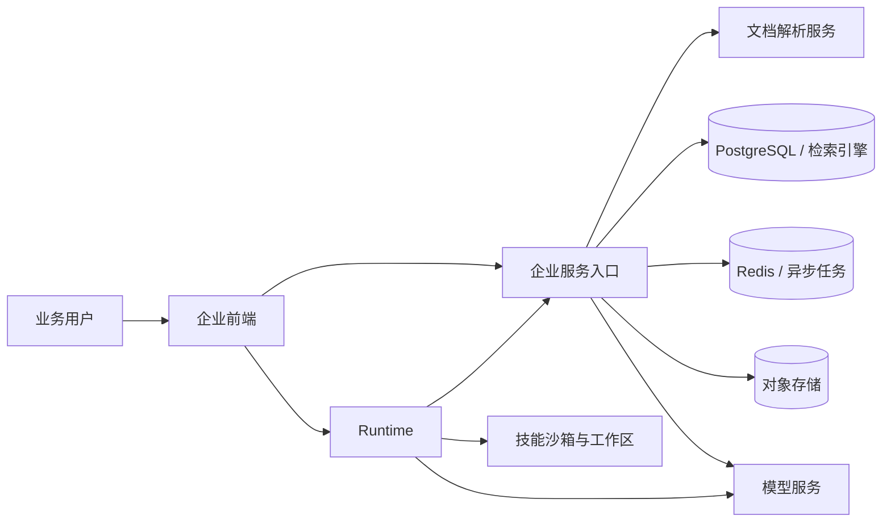

# 产品介绍

智能体中台2.0 面向企业知识服务与任务执行。管理员将文件和业务资料归入知识库，成员既可以用平台对话获得带引用的回答，也可以进入工作模式，让 Runtime 智能体围绕材料完成任务、生成文件并交付结果。

平台将知识问答、智能体编排、技能工具和企业级租户管理放在同一个前端入口中。平台服务负责知识库、模型、权限与检索问答，Runtime 负责工作线程、文件工作区和工具执行。

<Screenshot
  src="/screenshots/introduction-overview.png"
  caption="平台主界面：左侧导航与知识库、会话，右侧问答区"
  hint="展示登录后的主界面全貌：知识库、智能体、工作模式与设置入口，以及一轮带引用的问答。" />

## 核心价值

| 价值 | 产品表现 |
| --- | --- |
| 知识可追溯 | 回答基于企业知识库生成，并返回引用、来源文档和原文片段，便于核对与复核 |
| 问答与执行衔接 | 平台对话解决“查资料、问问题”，工作模式解决“让智能体完成多步骤任务” |
| 能力可组合 | 平台智能体、Runtime 智能体、技能、工具和 MCP 分别配置，再按业务场景组合使用 |
| 多租户治理 | 租户隔离知识、模型、会话和执行资源；成员按 Owner、Admin、Contributor、Viewer 分权 |
| 企业部署可控 | 模型、存储、检索引擎和 Runtime 沙箱可按企业环境接入，关键凭据由服务端管理 |

## 产品能力

| 能力 | 用户获得什么 | 典型场景 |
| --- | --- | --- |
| 平台对话 | 基于知识库的多轮问答，支持附件、流式回答和引用溯源 | 制度查询、产品资料问答、售后知识检索 |
| 工作模式 | 由 Runtime 智能体执行任务，展示过程并生成可交付文件 | 文档整理、数据汇总、方案生成、报价处理 |
| 知识库 | 统一管理文件、网页、Markdown、FAQ 和 Wiki 内容 | 企业知识沉淀、项目资料库、标准问答库 |
| 智能体 | 配置模型、知识范围、技能和工具，形成面向业务的执行助手 | 知识问答助手、资料分析助手、文件处理助手 |
| 技能与工具 | 提供 Office、文件处理、搜索等可调用能力 | 生成 PPT、处理表格、读取和整理文件 |
| MCP | 接入外部系统工具，供平台或 Runtime 智能体调用 | 连接业务系统、数据服务和自定义工具 |
| 工作区 | 保存工作模式使用的上传文件和生成结果 | 多步骤任务中的材料引用与交付物管理 |
| 数据总览 | 汇总平台对话、工作模式、知识库和用户使用情况 | 运营分析、使用趋势和资源观察 |
| 管理设置 | 管理租户、成员、模型、存储、检索和平台配置 | 企业初始化、权限治理与环境维护 |

## 两条使用路径

### 平台对话

用户先选择知识库、平台智能体和模型，再围绕业务资料提问。系统检索相关知识片段，由模型生成回答，并把引用和来源一并返回。适合需要快速获得可信答案、核对原文和持续追问的场景。

### 工作模式

用户创建工作线程并选择 Runtime 智能体。智能体可以读取工作区文件、调用技能和 MCP 工具、展示执行过程，并把结果保存为可下载文件。适合需要多步骤处理、材料整合或文档交付的场景。

两条路径共享登录、租户和权限体系，但服务不同的工作目标：平台对话偏知识查询，工作模式偏任务执行。

## 核心概念

| 概念 | 说明 |
| --- | --- |
| 租户 | 企业资源和成员的管理单元，知识库、模型、智能体、会话和配额均归属于租户 |
| 用户与成员 | 用户是登录身份；成员是用户在租户内的角色关系，不同角色拥有不同管理范围 |
| 知识库 | 资料的业务容器，决定内容从哪里来、如何解析、如何检索以及谁可以访问 |
| 知识与分块 | 知识是一份入库资料，分块是检索、引用和预览时使用的基本单位 |
| 平台会话 | 保存平台对话中的消息、引用、模型选择和知识范围 |
| 平台智能体 | 面向知识问答配置模型、知识库、提示词和交互方式 |
| 工作线程 | 保存工作模式中的任务消息、工具过程、生成文件和执行状态 |
| Runtime 智能体 | 面向任务执行编排模型、技能、工具、知识库和工作区 |
| 工作区 | 保存工作模式使用和生成的文件，任务执行时可以直接引用 |
| 技能与工具 | 技能封装完整任务能力，工具提供可被智能体调用的原子操作 |
| MCP | 连接外部系统的标准协议，为智能体提供额外工具和数据能力 |

## 角色路径

| 角色 | 主要工作 | 关注结果 |
| --- | --- | --- |
| 平台管理员 | 部署、初始化、模型与存储配置、租户和系统管理 | 服务稳定、权限清晰、资源可控 |
| 知识运营 | 建设知识库、导入资料、维护解析和 FAQ / Wiki 内容 | 资料完整、检索准确、引用可信 |
| 业务用户 | 使用平台对话查询资料，或进入工作模式完成任务 | 快速获得答案和可交付结果 |
| 开发者与集成方 | 通过企业 API、Runtime API、MCP 和配置扩展能力 | 接入稳定、边界清楚、便于维护 |

## 系统组成

| 组件 | 职责 |
| --- | --- |
| 企业前端 | 提供平台对话、工作模式、知识库、智能体、技能、工具、MCP、工作区和设置界面 |
| 企业服务入口 | 提供租户、权限、知识库、模型、检索问答、平台智能体和平台 MCP 服务 |
| Runtime | 提供工作模式线程、Runtime 智能体、技能、工具、工作区和沙箱执行 |
| 文档解析服务 | 将 PDF、Office、网页、图片等资料转换为可检索内容 |
| PostgreSQL / Redis | 保存业务数据、检索数据、会话状态和异步任务 |
| 对象存储 | 保存原始文件、解析图片和任务生成文件 |
| 模型服务 | 提供对话、向量、重排、视觉和语音能力 |

## 下一步

- [快速上手](./03-quickstart.md)：完成首次登录、建库、上传和问答。
- [安装部署](./02-installation.md)：使用 KJSC Compose 入口启动企业服务。
- [配置详解](./04-configuration.md)：了解企业配置优先级和环境变量展开规则。
