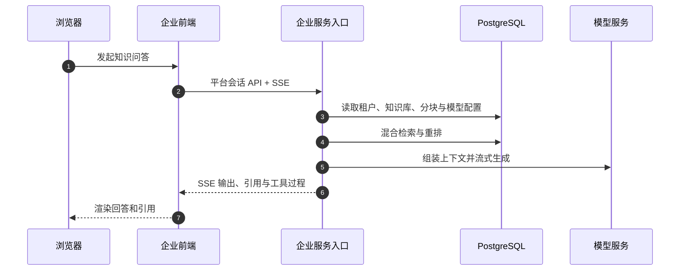
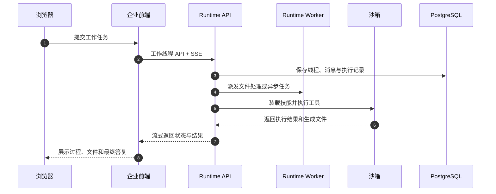

# 总体架构

智能体中台2.0 由企业前端、企业服务入口和 Runtime 组成。前端负责统一操作界面，企业服务入口负责知识问答与平台管理，Runtime 负责工作模式执行。三者共用身份与基础设施，但保持会话、智能体、MCP 和技能数据的明确边界。

## 系统组成

| 组件 | 位置 | 技术栈 | 默认端口 | 职责 |
| --- | --- | --- | --- | --- |
| 企业前端 | `apps/frontend` | Vue 3、TypeScript、Vite、TDesign、Pinia | 宿主机 `80` | 平台对话、工作模式、知识库、智能体、技能、工具、MCP、工作区、数据总览与设置 |
| 企业服务入口 | `apps/app-core` | Go、Gin、GORM | 宿主机 `8080`，容器内 `8080` | REST API、知识库、检索问答、模型、平台智能体、平台 MCP、租户身份与权限 |
| 文档解析服务 | Compose `docreader` 服务 | Python、gRPC | 容器内 `50051` | 文件解析、OCR、版式处理与图片提取 |
| Runtime API | `apps/agent-harness` | Python、FastAPI、Uvicorn | 宿主机 `9990`，容器内 `9990` | 工作模式对话、Runtime 智能体、技能、工具、Runtime MCP、工作区与数据总览 API |
| Runtime Worker | `apps/agent-harness` | Python、ARQ | 不发布 | 异步任务、文件处理与执行调度 |
| 沙箱供给服务 | `docker/sandbox_provisioner` | Python、Docker / Kubernetes API | 本机 `8002` | 创建、健康检查、回收 Runtime 执行沙箱 |
| 数据库 | Compose `postgres` 服务 | ParadeDB / PostgreSQL | 容器内 `5432` | 企业业务数据、Runtime 运行数据、全文与向量检索 |
| 缓存与队列 | Compose `redis` 服务 | Redis | 容器内 `6379` | 流管理、异步队列、缓存与协同 |
| 对象存储 | Compose `minio` 服务或外部存储 | S3 兼容协议 | 部署决定 | 知识文件、Runtime 工作区和生成文件 |

健康检查：

```bash
curl http://<app-host>:8080/health
curl http://<runtime-host>:9990/api/system/health
```

## 边界规则

| 边界 | 规则 |
| --- | --- |
| 会话 | 平台对话与工作模式对话分开建模、分开路由、分开查询 |
| 智能体 | 平台智能体配置知识问答；Runtime 智能体配置任务执行、工具和技能 |
| MCP | 平台 MCP 与 Runtime MCP 分表分权管理，不同步为同一份配置 |
| 知识库 | 企业服务入口是知识库管理方；Runtime 仅通过适配层读取和引用 |
| 工作区 | Runtime 管理工作模式文件，不等于租户，也不等于知识库 |
| 技能 | Runtime 技能与工具服务执行，不移植为平台侧独立技能系统 |

前端可以在同一导航体系中并列展示两类对象，但列表、详情、创建、编辑和调用必须保留来源标识，不能把 ID 或配置伪装成同一类资源。

## 请求链路

### 平台对话



### 工作模式



## Runtime 结构

`apps/agent-harness/server/routers/` 按资源拆分 API：

| 路由模块 | 职责 |
| --- | --- |
| `agent_router.py` | Runtime 智能体 |
| `chat_router.py` | 工作模式对话与线程 |
| `dashboard_router.py` | Runtime 数据总览 |
| `workspace_router.py` | 工作区 |
| `skill_router.py` | 技能目录、安装与调用 |
| `tool_router.py` | 工具目录与调用 |
| `mcp_router.py` | Runtime MCP |
| `model_provider_router.py` | Runtime 模型 Provider |
| `filesystem_router.py` | 执行环境文件访问 |
| `system_router.py` | 系统信息与健康检查 |
| `auth_router.py`、`user_router.py` | 身份投影与用户信息 |

主要进程入口是 `server/main.py` 与 `server/worker_main.py`。API 负责 HTTP 与 SSE，Worker 负责异步任务，沙箱供给服务负责隔离执行环境。

## 目录导览

| 路径 | 说明 |
| --- | --- |
| `apps/frontend/src` | 企业前端源码；路由、视图、状态、API 封装与功能开关 |
| `apps/app-core` | 企业服务入口源码；路由、业务服务、仓储、配置与容器装配 |
| `apps/agent-harness/server` | Runtime API 与 Worker 源码 |
| `apps/agent-harness/package` | Runtime 领域逻辑与技能相关包 |
| `migrations/version_kjsc` | 企业数据库迁移 |
| `config/config_kjsc.yaml` | 企业主配置 |
| `config/builtin_agents_kjsc.yaml` | 企业内置智能体 |
| `config/prompt_templates_kjsc` | 企业提示词模板 |
| `docker-compose-kjsc.yml` | 标准企业编排 |
| `docker-compose-mac.yml` | macOS 企业编排 |
| `scripts/kjsc` | 企业开发、构建、迁移与部署脚本 |
| `.env.kjsc.example` | 企业环境变量模板 |

较深实现继续保留在架构与开发文档中；这些文档的源码索引必须优先指向企业侧路径，不能把上游目录当作当前产品的修改入口。
