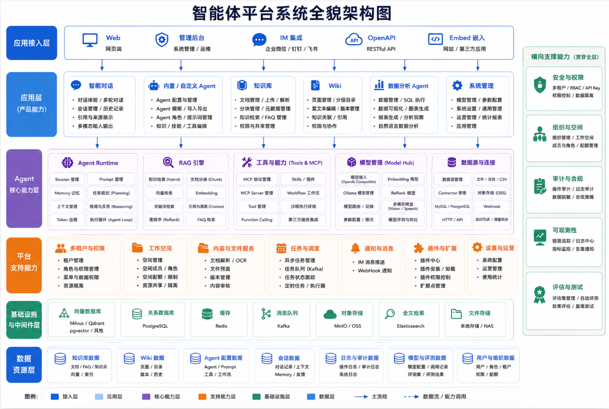
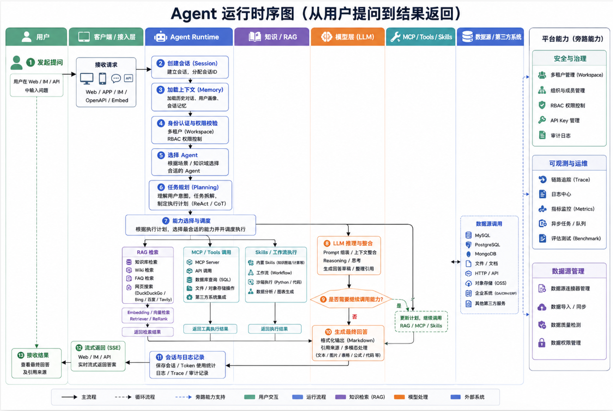

# 智能体中台 · 产品指南

让文档活起来：RAG 问答、Agent 推理与 Wiki 知识网络一体化的企业知识中台。

---

## 项目介绍

**智能体中台**面向企业级文档理解、语义检索与智能推理场景，帮助团队把分散文档沉淀为可查询、可推理、可持续演进的专属知识资产。

平台围绕三大核心能力构建：

| 能力 | 说明 |
|------|------|
| **RAG 快速问答** | 基于知识库的检索增强生成，适合日常知识查询 |
| **ReAct Agent 智能推理** | 自主编排知识检索、MCP 工具与网络搜索，完成复杂多步任务 |
| **Wiki 模式** | Agent 从原始文档自治生成相互链接的 Markdown 知识库与可视化知识图谱 |

支持十余种文档格式（PDF、Word、图片、Excel、EPUB、MHTML 等），可通过企业微信、飞书、钉钉等 IM 渠道直接提供问答服务；模型层面兼容 OpenAI、DeepSeek、Qwen、智谱、混元、Gemini、Ollama 等主流厂商。全流程模块化设计，大模型、向量数据库、存储等组件可灵活替换，支持本地与私有云部署，数据自主可控。

---

## 架构设计

### 系统全貌

平台自上而下分为接入、产品能力、Agent 核心、平台支撑、基础设施与数据资源等层次，安全、空间、审计与可观测能力横向贯穿各层。

| 层次 | 说明 |
|------|------|
| **应用接入层** | Web、管理后台、IM（企微 / 钉钉 / 飞书）、OpenAPI、网站嵌入 |
| **应用层（产品能力）** | 智能对话、内置/自定义 Agent、知识库、Wiki、数据分析 Agent、系统管理 |
| **Agent 核心能力层** | Agent 运行时、RAG 引擎、工具与 MCP、模型中枢 |
| **平台支持能力** | 多租户与权限、工作空间、内容与文件服务、任务调度、通知、插件扩展 |
| **基础设施与中间件** | 向量库、关系库、缓存、消息队列、对象存储、全文检索等 |
| **数据资源层** | 知识库、Wiki、Agent 配置、会话、审计与模型评估等业务数据 |
| **横向支撑** | 安全权限、组织空间、审计合规、可观测性、评测 |

### Agent 运行时序

从用户提问到结果返回，由接入层进入 Agent 运行时完成会话与权限校验，再经任务规划调度 RAG、工具/MCP 与 Skills，由大模型推理整合后流式返回；需要时可多轮循环调用能力。

典型链路：

1. 用户经 Web / IM / OpenAPI / 嵌入等渠道发起提问  
2. 创建会话、加载上下文，完成身份认证与空间权限校验  
3. 选择 Agent，进行意图理解与任务规划（如 ReAct）  
4. 按需调度：知识检索（知识库 / Wiki / FAQ / 网络搜索）、MCP 工具、Skills / 沙箱等  
5. LLM 整合上下文生成草案；若需继续调用能力则回到规划与调度  
6. 生成带引用的最终回答，记录会话与审计，经 SSE 流式返回客户端  

---

## 核心功能

### 知识库

知识库是平台的内容底座，负责把文件、FAQ 与结构化知识组织成可检索、可引用的资产，并供对话与 Agent 在运行时调用。

| 要点 | 说明 |
|------|------|
| **类型** | 文档知识库、FAQ 知识库、Wiki 知识库，按场景选用 |
| **入库** | 支持上传文件、文件夹、URL 导入与在线录入；覆盖 PDF / Word / Excel / 图片 / EPUB 等十余种格式 |
| **解析与分块** | 可按批次配置解析引擎、分块策略、多模态（VLM / ASR）与图谱抽取；支持批量重新解析 |
| **检索** | BM25、稠密向量、GraphRAG、父子分块等策略组合，提升召回与答案依据质量 |
| **治理** | 多标签、权限共享、活动审计；解析与检索链路可做端到端评估 |

业务侧常见用法：沉淀制度与产品文档供问答、维护 FAQ 标准答、为自定义 Agent 绑定一个或多个知识库作为专属知识范围。

### 智能体

智能体（Agent）定义「用什么知识、什么工具、以何种角色回答」。可选用内置能力，也可创建自定义 Agent 做场景化编排。

| 要点 | 说明 |
|------|------|
| **配置** | 角色与 Prompt、对话策略、模型选择、引用开关等 |
| **知识编排** | 绑定知识库 / Wiki，限定检索范围与阈值 |
| **工具与技能** | 接入 MCP 服务、内置工具、Skills；支持 `@Skill / @MCP` 按轮次限定可用能力 |
| **模板** | 支持配置的导入导出，便于在空间内复用与分发 |
| **运行时** | 会话管理、记忆与上下文、规划推理与多步工具调用循环（见上节时序图） |

适合客服助手、制度问答、研发助手、数据分析等需要稳定人设与固定工具链的场景。

### 智能对话

对话是用户使用 Agent 与知识的主入口，覆盖多轮交互、引用溯源与多端接入体验。

| 要点 | 说明 |
|------|------|
| **问答模式** | 快速 RAG 问答，或开启 Agent 推理完成复杂多步任务 |
| **多轮与会话** | 上下文感知；侧栏按 Web / IM / 嵌入等来源筛选与分组，支持标题重命名 |
| **引用与进度** | 回答可展示知识库 / 网络来源引用；RAG 流水线分阶段进度可见 |
| **输入增强** | 临时附件（图片 / 文档）、推荐问题与答后追问、多模态输入输出 |
| **多端一致** | 同一 Agent 可通过 Web、企业 IM、嵌入 Widget、OpenAPI 对外提供服务 |

用户侧感知为：选 Agent → 提问 → 流式看到思考/检索/工具过程（视配置）→ 得到带依据的回答并可继续追问。

### Wiki

Wiki 面向需要结构化沉淀与相互链接的知识网络，可由 Agent 从原始文档辅助生成与维护，并与图谱可视化配合使用。

| 要点 | 说明 |
|------|------|
| **页面与目录** | 层级目录、页面管理、富文本 / Markdown 编辑 |
| **关联** | 页面相互链接，形成可浏览的知识网络 |
| **版本与协作** | 版本管理，便于回溯与协作修订 |
| **与问答联动** | Wiki 内容可作为检索与引用源，进入对话与 Agent 能力闭环 |

适合产品手册、内部百科、项目知识库等需要「可读 + 可问」的场景。

---

## 功能一览

### 智能对话

| 能力 | 详情 |
|------|------|
| 智能推理 | ReAct 渐进式多步推理，自主编排知识检索、MCP 工具与网络搜索 |
| 快速问答 | 基于知识库的 RAG 问答，快速准确地回答问题 |
| Wiki 模式 | Agent 驱动从原始文档自动生成并维护结构化、相互链接的 Markdown Wiki |
| 工具调用 | 内置工具、MCP 工具（含 OAuth2）、网络搜索；支持 `@Skill / @MCP` 按轮次范围化运行时 |
| 对话策略 | 在线 Prompt 编辑、检索阈值调节、多轮上下文、按 Agent 引用输出开关 |
| 推荐问题 | 基于知识库内容自动生成推荐问题与答后追问 |
| 临时附件 | 会话级临时上传图片 / 文档，异步解析后用于一次性问答 |
| 引用与进度 | 对话内引用浮层与抽屉、统一 Markdown 渲染、RAG 流水线分阶段进度 |
| 会话管理 | 按来源（Web / IM / 嵌入）筛选与分组，支持标题内联重命名 |

### 知识管理

| 能力 | 详情 |
|------|------|
| 知识库类型 | FAQ / 文档 / Wiki，支持文件夹导入、URL 导入、多标签、在线录入 |
| 按批次解析 | 上传确认或按批次覆盖解析引擎、分块、多模态（VLM / ASR）、图谱抽取等 |
| 批量重新解析 | 一次为多篇文档重新排队解析，可携带批次级配置 |
| 文档格式 | PDF / Word / Txt / Markdown / HTML / EPUB / MHTML / 图片 / CSV / Excel / PPT / JSON |
| 检索策略 | BM25 / Dense / GraphRAG / 父子分块 / 多维度索引 |
| 端到端评估 | 检索 + 生成全链路可视化，评估召回与生成质量指标 |

### 集成与扩展

| 能力 | 详情 |
|------|------|
| 模型厂商 | OpenAI / Azure / Anthropic / DeepSeek / Qwen / 智谱 / 混元 / 豆包 / Gemini / MiniMax / NVIDIA / Ollama 等 |
| 向量数据库 | PostgreSQL (pgvector) / Elasticsearch / OpenSearch / Milvus / Weaviate / Qdrant 等 |
| 对象存储 | Local / MinIO / OSS / COS 等，支持每空间多实例存储后端 |
| IM 集成 | 企业微信 / 飞书 / 钉钉等主流企业 IM |
| 网站嵌入 | 通过嵌入 Widget 发布智能体（域名白名单、限流与安全模式） |
| 网络搜索 | DuckDuckGo / 百度 / Bing / Tavily 等 |
| API 集成 | 权限范围 API Key、能力级授权与程序化接入 |

### 平台能力

| 能力 | 详情 |
|------|------|
| 部署 | 本地 / Docker / Kubernetes，支持私有化部署 |
| 界面 | Web UI / RESTful API / 命令行 |
| 权限控制 | 空间 RBAC（Owner / Admin / Contributor / Viewer）、资源归属、审计日志 |
| 安全 | 凭据加密存储、传输加固、防 SSRF、Agent 技能沙箱隔离 |
| 可观测性 | 全链路追踪（Agent 循环、Token、工具调用、解析时间线）、运行时任务队列面板 |
| 任务管理 | MQ 异步任务与分阶段 Worker 池治理 |
| 模型管理 | 集中配置、知识库级模型选择、交互式模型调试 |

---

## 文档导航

### 项目概述

| 页面 | 简介 |
|------|------|
| [版本路线图](/product/项目概述/版本路线图) | 产品规划与计划方向 |

### 核心功能详解

| 页面 | 简介 |
|------|------|
| [知识图谱](/product/核心功能/知识图谱) | 知识图谱快速开始与使用 |
| [开启知识图谱功能](/product/核心功能/开启知识图谱功能) | 完整启用流程 |
| [MCP功能使用说明](/product/核心功能/MCP功能使用说明) | MCP 服务用户操作指南 |
| [内置MCP服务管理](/product/核心功能/内置MCP服务管理) | 内置 MCP 系统级管理 |
| [内置模型管理](/product/核心功能/内置模型管理) | 内置模型配置与管理 |
| [Agent技能系统](/product/核心功能/Agent技能系统) | Skills 扩展机制 |

### 安全与协作

| 页面 | 简介 |
|------|------|
| [OIDC认证调用流程](/product/安全认证/OIDC认证调用流程) | OIDC 第三方登录 |
| [空间RBAC说明](/product/安全认证/RBAC说明) | 角色矩阵与资源归属 |
| [共享空间说明](/product/安全认证/共享空间说明) | 跨空间协作与共享 |

### 开发与 API

技术集成、本地开发与接口说明请前往 [开发指南](/develop/) 与 [API 参考](/api/)。
